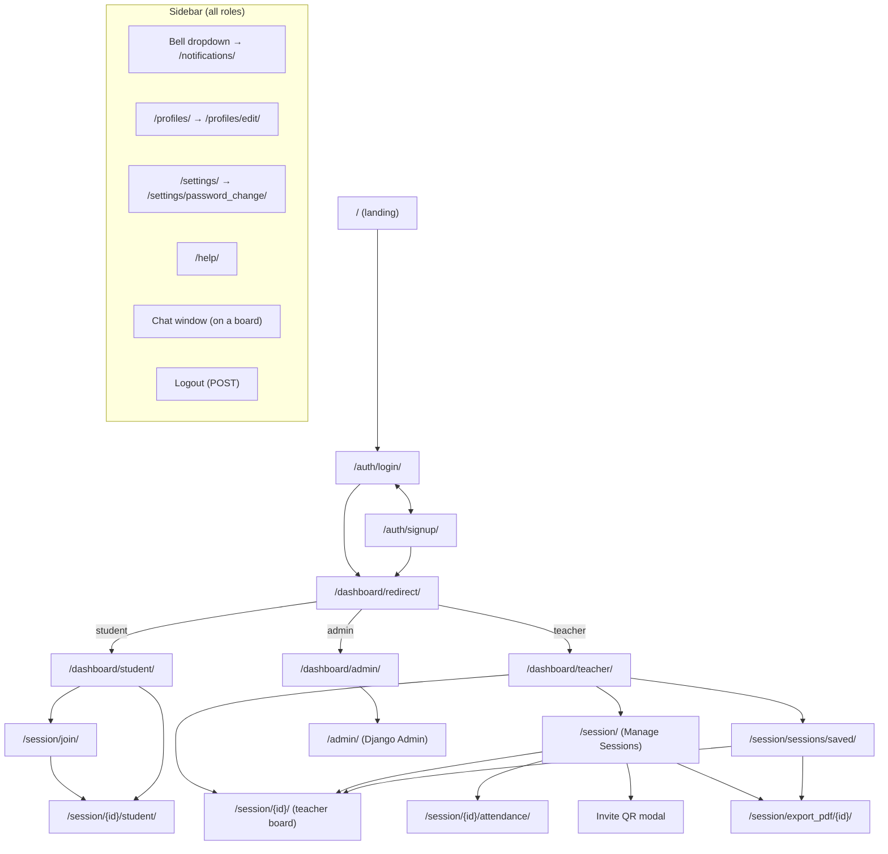
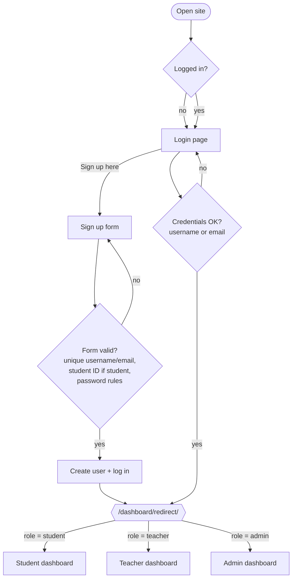
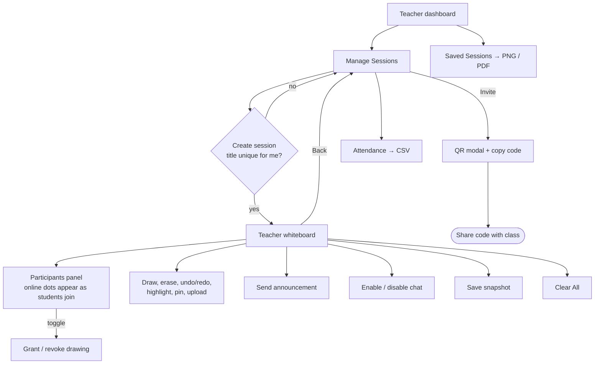
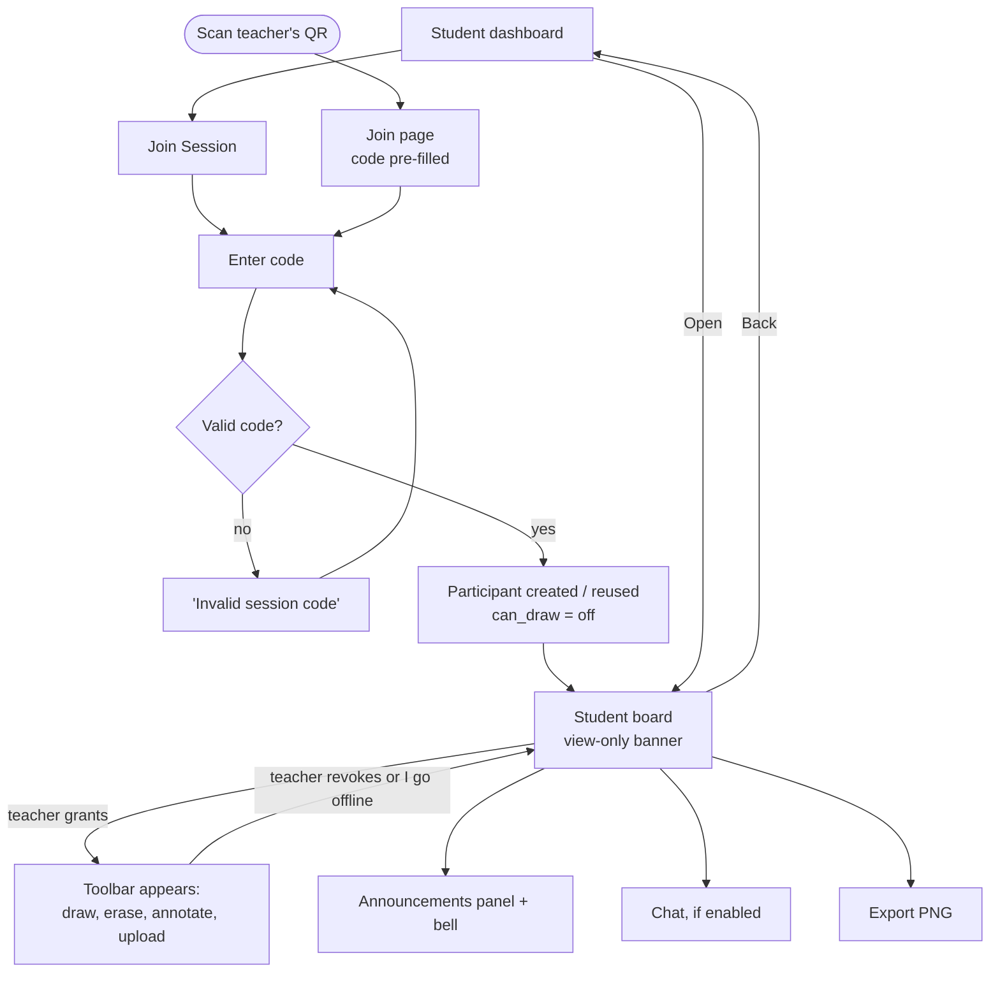
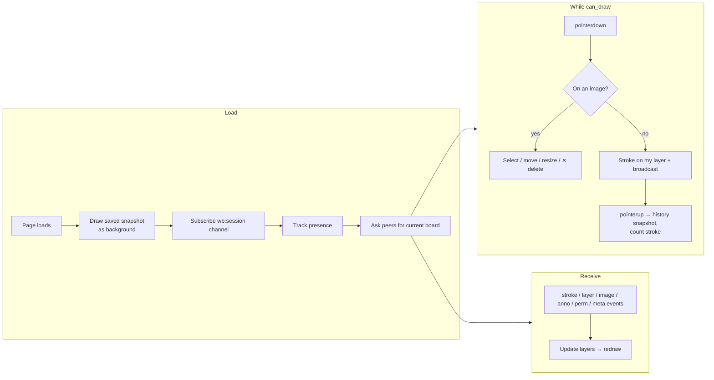
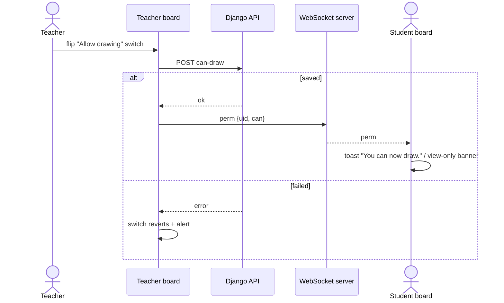
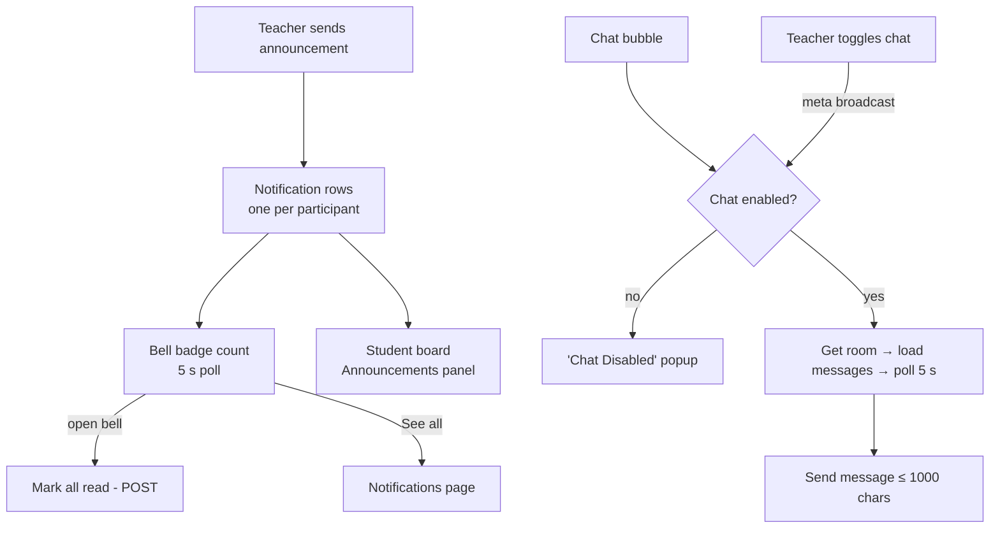

# Application Flow

**System:** COLLABoard: Collaborative Whiteboard
**Version:** 1.0 · **Date:** 2026-10-14

This document maps every screen, who can reach it, and how users move between screens. URL names match `urls.py`.

---

## 1. Site map

## 2. Screen inventory

| Screen | URL | Roles | Template | Main actions |
|---|---|---|---|---|
| Landing | `/` | anyone | none (redirect) | → Login |
| Login | `/auth/login/` | anyone | `authentication/login.html` | Log in with username or email; link to Sign up |
| Sign up | `/auth/signup/` | anyone | `authentication/signup.html` | Create a student/teacher account |
| Student dashboard | `/dashboard/student/` | student | `dashboard/student_dashboard.html` | Join session, open joined sessions, participation chart |
| Teacher dashboard | `/dashboard/teacher/` | teacher | `dashboard/teacher_dashboard.html` | Recent sessions, Manage Sessions, performance table + chart |
| Admin dashboard | `/dashboard/admin/` | admin | `dashboard/admin_dashboard.html` | Platform counts, links to Django Admin |
| Manage sessions | `/session/` | teacher, admin | `session/session_list.html` | Create, search, open, attendance, invite (QR), PDF, duplicate, delete |
| Saved sessions | `/session/sessions/saved/` | teacher, admin | `session/saved_sessions.html` | Open snapshot, PNG, PDF, open board |
| Join session | `/session/join/?code=` | any logged-in user | `session/join_session.html` | Enter or confirm code |
| Teacher board | `/session/{id}/` | owner, staff | `session/whiteboard.html` | Draw tools, Clear All, Save, chat toggle, upload, participants, announcements |
| Student board | `/session/{id}/student/` | participant | `session/whiteboard.html` | Draw tools when allowed, upload when allowed, announcements panel, chat |
| Attendance | `/session/{id}/attendance/` | owner, staff | `session/attendance.html` | Live table, CSV export |
| Notifications | `/notifications/` | all | `notifications/notifications.html` | Full list of notifications |
| Profile / Edit | `/profiles/`, `/profiles/edit/` | all | `profiles/*.html` | View profile, change email |
| Settings | `/settings/` | all | `settings_app/settings.html` | Links to profile, password change, help, logout |
| Change password | `/settings/password_change/` | all | `settings_app/password_change.html` | Change password (stays logged in) |
| Help | `/help/` | all | `help_app/help.html` | FAQs |
| Django Admin | `/admin/` | staff | Django | Manage users, sessions, notifications, chat |

## 3. Authentication flow

The login page is shown even to logged-in users (intentional: lets users switch accounts). A `next` parameter is ignored; users always land on their dashboard.

## 4. Teacher flow: running a class

## 5. Student flow: joining and participating

## 6. Whiteboard interaction flow (inside the board)

## 7. Permission change flow

## 8. Notification and chat flow

## 9. Error and edge states

| Situation | What the user sees |
|---|---|
| Wrong login | "⚠️ Invalid credentials. Please try again." |
| Student opens teacher URL of a session they joined | Redirected to the student board |
| Anyone opens a board they did not join | Redirected to Join page with "You are not part of this session…" |
| Student opens teacher-only page (sessions, saved) | Redirected to own dashboard with "🚫 You do not have permission…" |
| Duplicate session title | "You already have a session named '…'" on Manage Sessions |
| Upload too large / wrong type | Toast "⚠️ File is larger than 10 MB." / "⚠️ Unsupported file type." |
| Upload while view-only | "You don't have permission to upload (ask the teacher to enable drawing)." |
| Save fails (disk error, file too large) | Toast "Save failed." |
| PDF export with no snapshot | "No snapshot available" (404). The PDF button only shows when a snapshot exists |
| Chat disabled mid-conversation | Input disabled, "Chat Disabled" popup |
| WebSocket disconnected (network drop, server restart) | Board keeps working locally; client reconnects automatically (backoff up to 10 s) and re-syncs strokes |
