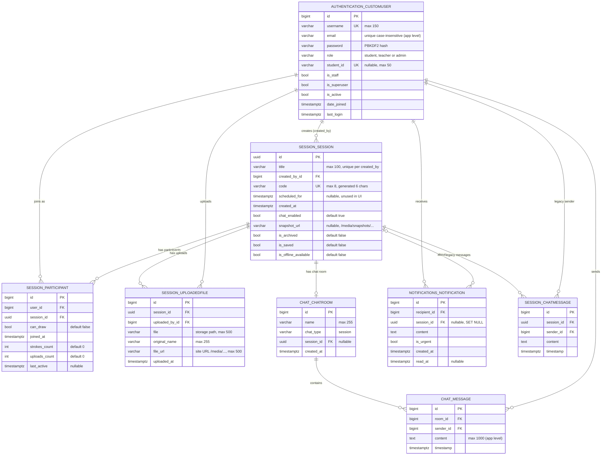

# Backend Schema

**System:** COLLABoard: Collaborative Whiteboard
**Version:** 1.0 · **Date:** 2026-10-14 · **Migrations:** authentication 0001, session 0005, chat 0001, notifications 0003 · **Database:** SQLite (default) or PostgreSQL

Covers the relational schema, file storage layout, HTTP API and the WebSocket (realtime) message protocol.

---

## 1. Entity-relationship diagram



Django's own tables (`django_session`, `auth_group`, `auth_permission`, `django_admin_log`, `django_content_type`, `django_migrations`, and the user↔group/permission join tables) are omitted.

## 2. Table reference

### 2.1 `authentication_customuser` (model `CustomUser`, extends `AbstractUser`)

| Column | Type | Constraints | Notes |
|---|---|---|---|
| `id` | bigint | PK | |
| `username` | varchar(150) | unique, not null | Letters, digits, `@ . + - _` |
| `email` | varchar(254) | | Stored lower-case; uniqueness enforced by signup/profile forms |
| `password` | varchar(128) | not null | Django hasher string |
| `role` | varchar(20) | default `student` | `student`, `teacher`, `admin`; superusers forced to `admin` on save |
| `student_id` | varchar(50) | unique, nullable | Required for students; NULL for others (avoids `''` collisions) |
| `first_name`, `last_name` | varchar(150) | blank | Not used in UI |
| `is_staff`, `is_superuser`, `is_active` | bool | | Django auth |
| `date_joined`, `last_login` | timestamptz | | |

### 2.2 `session_session` (model `Session`)

| Column | Type | Constraints | Notes |
|---|---|---|---|
| `id` | uuid | PK, default uuid4 | Used in all URLs |
| `title` | varchar(100) | **unique (`created_by_id`, `title`)**, constraint `unique_session_title_per_owner` | App also blocks case-insensitive duplicates |
| `created_by_id` | bigint | FK → customuser, ON DELETE CASCADE | related name `created_sessions` |
| `code` | varchar(8) | unique | 6 chars from `ABCDEFGHJKMNPQRSTUVWXYZ23456789` |
| `scheduled_for` | timestamptz | nullable | Reserved for scheduling |
| `created_at` | timestamptz | auto | |
| `chat_enabled` | bool | default true | |
| `snapshot_url` | varchar(500) | nullable | URL of latest snapshot, e.g. `/media/snapshots/<id>_<ts>.png` |
| `is_archived` | bool | default false | Archived sessions cannot be joined |
| `is_saved`, `is_offline_available` | bool | default false | Set when a snapshot is saved |

### 2.3 `session_participant` (model `Participant`)

| Column | Type | Constraints | Notes |
|---|---|---|---|
| `id` | bigint | PK | |
| `user_id` | bigint | FK → customuser, CASCADE | |
| `session_id` | uuid | FK → session, CASCADE | related name `participants` |
| `can_draw` | bool | default false | Draw/annotate/upload permission |
| `joined_at` | timestamptz | auto | First join |
| `last_active` | timestamptz | nullable | Updated on join, stroke, upload, presence |
| `strokes_count` | int ≥ 0 | default 0 | Incremented by `/stroke/` (atomic `F()` update) |
| `uploads_count` | int ≥ 0 | default 0 | Incremented on upload |

> Recommended next migration: `UniqueConstraint(user, session)` after removing any duplicate rows.

### 2.4 `session_uploadedfile` (model `UploadedFile`)

| Column | Type | Constraints | Notes |
|---|---|---|---|
| `id` | bigint | PK | |
| `session_id` | uuid | FK, CASCADE | related name `uploads` |
| `uploaded_by_id` | bigint | FK, CASCADE | |
| `file` | varchar(500) | | Storage key (`session_files/<session>/<ts>_<name>`) |
| `original_name` | varchar(255) | default `''` | Shown in the board file list |
| `file_url` | varchar(500) | default `''` | Site-relative URL, e.g. `/media/session_files/…` |
| `uploaded_at` | timestamptz | auto | |

### 2.5 `chat_chatroom` / `chat_message`

| Table | Column | Type | Notes |
|---|---|---|---|
| `chat_chatroom` | `id` | bigint PK | |
| | `name` | varchar(255) | `Session <uuid> Chat` |
| | `chat_type` | varchar(20) | `session` |
| | `session_id` | uuid FK nullable, CASCADE | related name `chat_room` (one room per session via `get_or_create`) |
| | `created_at` | timestamptz | |
| `chat_message` | `id` | bigint PK | |
| | `room_id` | bigint FK, CASCADE | related name `messages`, ordered by `timestamp` |
| | `sender_id` | bigint FK, CASCADE | related name `chat_messages_sent` |
| | `content` | text | ≤ 1000 chars enforced by API |
| | `timestamp` | timestamptz | |

### 2.6 `notifications_notification` (model `Notification`)

| Column | Type | Constraints | Notes |
|---|---|---|---|
| `id` | bigint | PK | |
| `recipient_id` | bigint | FK, CASCADE | related name `notifications` |
| `session_id` | uuid | FK nullable, **SET NULL** | Announcement source |
| `content` | text | | First line = title, rest = body |
| `is_urgent` | bool | default false | |
| `created_at` | timestamptz | auto | default ordering `-created_at` |
| `read_at` | timestamptz | nullable | `is_read` property |
| index | | `notif_recipient_read_idx (recipient_id, read_at)` | Speeds unread counts |

The previous `unique_together (recipient, session, content, is_urgent)` was removed in `0003_allow_repeat_announcements`; duplicates are now suppressed only within 10 seconds (`notify()`).

### 2.7 `session_chatmessage` (legacy)
Kept for migration history; no code writes to it. Live chat uses `chat_message`. Safe to drop in a future migration once old data is archived.

## 3. File storage layout (`MEDIA_ROOT`, served at `/media/`)

```
media/                                     (MEDIA_ROOT; set to a persistent disk in production)
├── snapshots/
│   ├── 3f6c…-…-9a1e_1760425200.png       ← snapshot: <session_uuid>_<unix_ts>.png
│   └── 3f6c…-…-9a1e_1760428800.png       ← newer snapshot (session.snapshot_url points here)
└── session_files/
    └── 3f6c…-…-9a1e/
        ├── 1760425311_worksheet.pdf      ← upload: <unix_ts>_<sanitized name>
        └── 1760425350_diagram.png
```

Files are served by `modules.core.views.media` in every environment (not only `DEBUG=True`). URLs are unguessable (session UUID + timestamp) but not access-controlled, like a public bucket. The database itself is one file: `SQLITE_PATH` (default `./db.sqlite3`, WAL mode).

## 4. HTTP API

All endpoints require login (redirect to `/auth/login/` otherwise) unless noted. POST endpoints need the CSRF token (`X-CSRFToken` header or form field). JSON errors look like `{"ok": false, "error": "<code>"}`.

### 4.1 Pages (HTML)

| Method | Path | Name | Access |
|---|---|---|---|
| GET | `/` | `landing` | public → redirect to login |
| GET/POST | `/auth/login/` | `auth:login` | public |
| GET/POST | `/auth/signup/` | `auth:signup` | public |
| POST | `/auth/logout/` | `auth:logout` | logged in |
| GET | `/dashboard/redirect/` | `redirect_dashboard` | any role |
| GET | `/dashboard/student/` | `student_dashboard` | logged in |
| GET | `/dashboard/teacher/` | `teacher_dashboard` | teacher |
| GET | `/dashboard/admin/` | `admin_dashboard` | admin |
| GET | `/session/?q=` | `session_list` | teacher, admin |
| POST | `/session/create/` | `create_session` | teacher, admin (`title`) |
| GET | `/session/sessions/saved/` | `saved_sessions` | teacher, admin |
| GET/POST | `/session/join/?code=` | `join_session` | logged in (`code`) |
| GET | `/session/{id}/` | `whiteboard` | owner/staff (participants redirected) |
| GET | `/session/{id}/student/` | `student_whiteboard` | participant |
| GET | `/session/{id}/attendance/[?export=csv]` | `attendance` | owner/staff |
| POST | `/session/delete/{id}/` | `delete_session` | owner/staff |
| POST | `/session/duplicate/{id}/` | `duplicate_session` | owner/staff |
| GET | `/session/qr/{id}/` | `session_qr` | owner/staff → `image/png` |
| GET | `/session/export/{id}/` | `export_session` | owner/staff → redirect to snapshot PNG |
| GET | `/session/export_pdf/{id}/` | `export_session_pdf` | owner/staff → `application/pdf` |
| GET | `/notifications/` | `notifications:notifications` | logged in |
| GET | `/profiles/`, GET/POST `/profiles/edit/` | `profile`, `edit_profile` | logged in |
| GET | `/settings/`, GET/POST `/settings/password_change/` | `settings`, `password_change` | logged in |
| GET | `/help/` | `help` | logged in |
| * | `/admin/` | Django Admin | staff |

### 4.2 Whiteboard JSON API (`modules/session`)

| Method | Path | Access | Request | Success response |
|---|---|---|---|---|
| POST | `/session/{id}/participants/{user_id}/can-draw/` | owner | JSON `{"can_draw": true}` (or form) | `{"ok":true,"user_id":5,"can_draw":true}` · 403 `forbidden`, 404 `participant_not_found` |
| POST | `/session/{id}/upload/` | owner/staff, or participant with `can_draw` | multipart `file` (≤ 10 MB; png, jpg, jpeg, gif, webp, pdf, docx, pptx) | `{"ok":true,"file_url":"https://…","name":"a.png","is_image":true}` · 400 `no_file` / size / type, 403 `permission_denied` |
| POST | `/session/{id}/stroke/` | participant with `can_draw` | empty | `{"ok":true}` · 403 `not_participant` / `view_only` |
| POST | `/session/{id}/toggle-chat/` | owner/staff | empty | `{"ok":true,"chat_enabled":false,"session_id":"…"}` |
| POST | `/session/{id}/presence/sync/` | owner/staff (**CSRF-exempt**, sendBeacon) | JSON `{"present_user_ids":[3,5]}` | `{"ok":true,"updated_count":1,"present":[3,5],"absent":[7]}` |
| GET | `/session/{id}/attendance.json` | owner/staff | | `{"ok":true,"now":"…","participants":[{"user_id","username","email","can_draw","joined_at","last_active"}]}` |
| POST | `/session/save_snapshot/{id}/` | owner/staff | multipart `image` (PNG, ≤ 15 MB) | `{"ok":true,"url":"/media/snapshots/…png"}` · 400 `not_png` / `too_large`, 500 on disk error |

### 4.3 Chat API (`modules/chat`)

| Method | Path | Access | Request | Response |
|---|---|---|---|---|
| GET | `/chat/session/{session_id}/` | owner or participant | | `{"room_id":12,"chat_enabled":true}` · 403 `{"chat_enabled":false}` |
| GET | `/chat/{room_id}/messages/` | owner or participant, chat enabled | | `{"chat_enabled":true,"messages":[{"id","sender","content","timestamp":"HH:MM"}]}` |
| POST | `/chat/{room_id}/send/` | owner or participant, chat enabled | JSON `{"content":"hi"}` (1–1000 chars) | `{"chat_enabled":true,"message":{…}}` · 400 `Empty` / `Too long` / `Bad JSON` |

### 4.4 Notifications API (`modules/notifications`, namespace `notifications`)

| Method | Path | Access | Request | Response |
|---|---|---|---|---|
| GET | `/notifications/unread-count/` | self | | `{"count":3}` |
| GET | `/notifications/latest/` | self | | `{"items":[{"id","content","is_urgent","created_at","read_at","session_id"}]}` (20 newest) |
| POST | `/notifications/mark-all-read/` | self | | `{"ok":true}` |
| POST | `/notifications/{pk}/read/` | recipient | | `{"ok":true}` · 404 if not yours/already read |
| POST | `/notifications/announce/{session_id}/` | owner/staff | form `message` (≤ 1000), `urgent=1` | `{"ok":true,"sent":24}` |
| GET | `/notifications/session/{session_id}/list/` | owner/staff | | grouped announcements `{"items":[{"id","content","is_urgent","created_at","recipient_count"}]}` |
| GET | `/notifications/session/{session_id}/mine/` | participant/owner/staff | | the caller's announcements for that session (50 newest) |
| GET | `/media/{path}` | public (unguessable URLs) | | uploaded file or snapshot |

## 5. Realtime protocol (WebSocket)

### 5.1 Connection

| Item | Value |
|---|---|
| URL | `ws(s)://<host>/ws/board/{session_uuid}/` |
| Server | `modules/session/consumers.py` → `BoardConsumer` (Django Channels, group `board_{session_uuid}`) |
| Client | `modules/core/static/core/js/realtime.js` → `CollabRealtime.channel(sessionId)` (exposed as `window.WhiteboardChannel`) |
| Auth | Django session cookie (`AuthMiddlewareStack`) + `AllowedHostsOriginValidator` |
| Who may connect | session owner, staff, or a Participant. Everyone else is closed with code **4403** (client stops reconnecting) |
| Reconnect | automatic, exponential backoff 0.5 s → 10 s; on reconnect the client re-tracks presence, re-sends its own layer and asks peers to sync |
| Limits | messages > 2 MB are dropped; single server process (in-memory channel layer) |

Notifications and announcements do **not** use the socket; they poll (`/notifications/latest/` every 5 s, session list every 10 s).

### 5.2 Frames

| Direction | Frame | Meaning |
|---|---|---|
| client → server | `{"type":"broadcast","event":E,"payload":{…}}` | relay to everyone else in the session (never echoed to the sender) |
| client → server | `{"type":"track","meta":{…}}` | set my presence metadata (server overwrites `uid` and `role`) |
| server → client | `{"type":"broadcast","event":E,"payload":{…}}` | relayed event |
| server → client | `{"type":"presence","state":{"5":[{"uid":"5","role":"teacher"}], "7":[…]}}` | full presence state after any join/track/leave (one entry per open tab) |

### 5.3 Server-side rules

| Event | Who may send |
|---|---|
| `stroke`, `image`, `anno` | teacher, or student whose `can_draw` is true (updated live from `perm` events, loaded from the DB on connect) |
| `stroke`/`image` with `t: "clear_all"` | teacher only |
| `perm`, `meta` | teacher only |
| `sync` | anyone connected |
| anything else | dropped |

For `stroke` and `sync` the server **overwrites `payload.sid` with the sender's user id**, so nobody can draw on, or replace, someone else's layer.

### 5.4 Broadcast events

Coordinates `x, y, w, h` are **normalized 0–1** relative to the sender's canvas.

| Event | `payload.t` | Fields | Sender | Receiver behaviour |
|---|---|---|---|---|
| `stroke` | `begin` | `x, y, c` (hex color or `"eraser"`), `w` (px), `sid` | drawer | start path on layer `sid` |
| `stroke` | `draw` / `end` | `x, y, sid` | drawer | `lineTo` + stroke |
| `stroke` | `layer` | `sid`, `img` (PNG data URL) | drawer (undo, redo, eraser, sync reply) | replace layer `sid` |
| `stroke` | `clear_all` | `sid` | teacher | clear background + all layers, reset history |
| `image` | `add` | `id, url, x, y, w, h, r?` | uploader / teacher (sync) | load image if `id` unknown |
| `image` | `move` / `resize` / `transform` / `rotate` | `id, x, y, w, h, r` | mover (≤ 1 per 80 ms) | update placement |
| `image` | `delete` | `id` | deleter | remove image |
| `image` | `clear_all` | | teacher | remove all images |
| `anno` | highlight / pin / `clear` | see `annotations.js` | annotator | update overlay |
| `perm` | | `uid` (number or `"all"`), `can` (bool) | teacher | if it applies to me → set `WhiteboardApp.canDraw` |
| `meta` | `chat` | `enabled` (bool) | teacher | `applyChatEnabled(enabled)` |
| `sync` | `request` | `sid` | newly subscribed client | every client with ink replies `stroke/layer`; teacher re-sends `image/add` |

### 5.5 Example messages

```json
{ "type": "broadcast", "event": "stroke",
  "payload": { "t": "begin", "x": 0.4121, "y": 0.2210, "c": "#e74c3c", "w": 4, "sid": "5" } }

{ "type": "broadcast", "event": "perm",
  "payload": { "uid": 7, "can": true } }

{ "type": "broadcast", "event": "image",
  "payload": { "t": "add", "id": "8c1e…", "url": "/media/session_files/3f6c…/1760425350_diagram.png",
               "x": 0.30, "y": 0.30, "w": 0.40, "h": 0.25 } }
```

## 6. Data lifecycle

| Event | Effect |
|---|---|
| Delete user | Cascades to their sessions, participations, uploads, messages and notifications |
| Delete session | Cascades to participants, uploads, chat room + messages; notifications keep text but `session_id → NULL` |
| Save snapshot | New file in `media/snapshots/`; `snapshot_url` points to newest (older snapshots stay on disk) |
| Duplicate session | New row with new code; shares the same `snapshot_url` (no file copy) |

Files in `media/` are **not** deleted automatically when sessions are deleted; see Implementation Plan task R-07.
