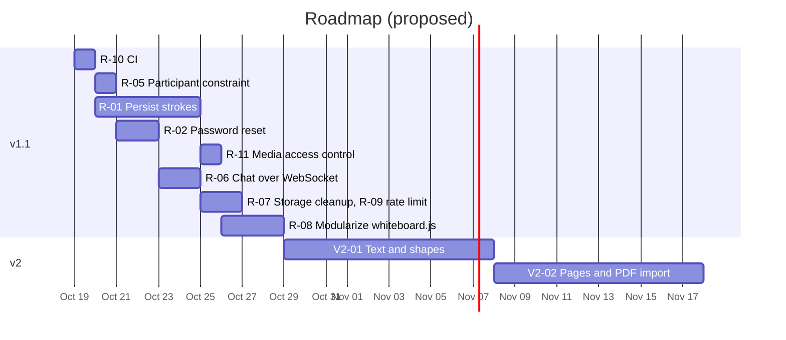

# Implementation Plan

**System:** COLLABoard: Collaborative Whiteboard
**Version:** 1.0 · **Date:** 2026-10-14
**Team:** Erik Samuel L. Bien (Lead Developer), Angel Anel C. Beato (Developer), Paul Andrei E. Bibit (Developer)

---

## 1. Status summary

| Area | State |
|---|---|
| v1 feature set (PRD §6) | ✅ Implemented |
| Refinement pass (`refine/fixes-and-docs`, merged to `main`) | ✅ 40+ defects fixed, 67 automated tests, docs written |
| Supabase removal | ✅ SQLite + local media + built-in WebSocket server (§3.3) |
| v1.1 (stability + persistence) | ⏳ Planned, §5 |
| v2 (richer tools, integrations) | 💡 Proposed, §5 |

## 2. Delivery history (from git)

```mermaid
gantt
    title COLLABoard: delivered work
    dateFormat YYYY-MM-DD
    axisFormat %b %d
    section Foundation
    Django project, modular apps, custom user      :done, f1, 2025-09-24, 7d
    Login / signup pages, roles                    :done, f2, 2025-09-28, 12d
    section Core features
    Settings, profile, dashboards                  :done, c1, 2025-10-05, 10d
    Sessions, QR invite, whiteboard v1             :done, c2, 2025-10-12, 12d
    Realtime sync, permissions, presence           :done, c3, 2025-10-20, 14d
    Uploads (move, resize, rotate), annotations    :done, c4, 2025-10-28, 10d
    Chat, notifications, announcements             :done, c5, 2025-11-03, 14d
    section Polish
    UI redesign (auth, dashboards, settings)       :done, p1, 2025-11-15, 14d
    Attendance, FAQs, bug fixes                    :done, p2, 2025-11-25, 10d
    section Refinement
    Code audit, fixes, tests, documentation        :done, r1, 2026-10-14, 1d
    Supabase removal: SQLite, media, Channels      :done, r2, 2026-10-14, 1d
```

## 3. Refinement fix log (this branch)

Severity: 🔴 crash / data-loss / security · 🟠 broken feature · 🟡 wrong data or UX bug · ⚪ hygiene.

### 3.1 Backend

| # | Sev | Problem | Fix | Files |
|---|---|---|---|---|
| B-01 | 🔴 | App could not start (or run tests) without Supabase credentials: three modules created a Supabase client at import time | First made lazy/optional; then Supabase was removed entirely (§3.3) | session views, `notify.py` |
| B-02 | 🔴 | `presence_sync` crashed (`NameError`) whenever no student was present, including every time the teacher left the board (code was mis-indented into a loop) | Rewrote logic; regression test | `session/views/manage_views.py` |
| B-03 | 🔴 | Any logged-in user could open any teacher board by UUID | Owner/staff only; participants redirected to student view; others to Join | `session/views/whiteboard_views.py` |
| B-04 | 🔴 | `requirements.txt` saved as UTF-16; fragile for pip/build tooling | Converted to UTF-8 | `requirements.txt` |
| B-05 | 🟠 | Session titles were unique **site-wide**: two teachers could not both have "Algebra" | Unique per teacher (`UniqueConstraint`), case-insensitive check | `session/models.py`, migration `0004` |
| B-06 | 🟠 | "Duplicate session" always crashed (copied a unique title) | Generates "(copy)", "(copy 2)"…; POST only | `upload_views.py` |
| B-07 | 🟠 | PDF export always returned 404 (looked in the wrong place for the snapshot) | Reads the snapshot file from `media/snapshots/` and converts with Pillow | `upload_views.py` |
| B-08 | 🟠 | Uploads were never recorded, so dashboard "Uploads" was always 0; any file type/size accepted | `UploadedFile` row + `uploads_count`; allow-list, 10 MB cap, sanitized names; stored in `media/` | `upload_views.py`, models |
| B-09 | 🟠 | Strokes were never counted (endpoint returned 403 for teachers and was commented out) | Students POST `/stroke/` after each stroke; atomic `F()` increment | `api_views.py`, `whiteboard.js` |
| B-10 | 🟠 | Teacher dashboard counted messages from the unused legacy table and showed strokes as 0; students in several sessions appeared once per session | Uses `chat.Message`, real stroke counts, one row per student | `dashboard/views.py` |
| B-11 | 🟠 | Admin dashboard showed hard-coded fake numbers; `/admin/` was not routed | Live counts + recent sessions; Django Admin enabled; models registered | `dashboard`, `urls.py`, `admin.py` files |
| B-12 | 🟠 | Teachers could never re-send the same announcement text (DB unique constraint silently dropped it but reported "sent") | Removed constraint; 10-second double-click suppression | `notifications/notify.py`, migration `0003` |
| B-13 | 🟠 | With Supabase as the DB, the "Supabase mirror" inserted every notification twice | Mirror removed with Supabase | `notify.py`, settings |
| B-14 | 🟠 | Login page asks for "Username / Institutional Email" but email login never worked | `EmailOrUsernameModelBackend` | `authentication/backends.py` |
| B-15 | 🟠 | Password errors shown twice (two complexity validators configured) | Removed duplicate validator | settings |
| B-16 | 🟠 | `create_session` GET rendered a template that does not exist (500) | Redirects to session list | `base_views.py` |
| B-17 | 🟠 | Password-reset/change routes under `/auth/` pointed to missing templates (500) | Removed; password change lives in Settings | `authentication/urls.py` |
| B-18 | 🟡 | Users with an unknown role hit a `NoReverseMatch` on redirect | Redirect to `auth:login` | `dashboard/views.py` |
| B-19 | 🟡 | Signup sent the new user back to the login page | Goes straight to their dashboard | `authentication/views.py` |
| B-20 | 🟡 | Profile email could be set to an invalid or already-used address | Validation + uniqueness | `profiles/views.py` |
| B-21 | 🟡 | Mark-read endpoints accepted GET (CSRF-able state change) | POST only | `notifications/views.py`, `Bell.js` |
| B-22 | 🟡 | QR code encoded only the code text | QR opens `/session/join/?code=…` with the code pre-filled | `upload_views.py`, `join_session.html` |
| B-23 | 🟡 | Behind Render's proxy, absolute URLs were `http://` (mixed content) and cookies were not secure | `SECURE_PROXY_SSL_HEADER`, secure cookies, CSRF trusted origins, env-driven hosts, DEBUG off by default on Render | settings |
| B-24 | ⚪ | Migration `0003` is named for `is_archived` but never added it | Idempotent add in `0004` (safe if the column already exists) | `session/migrations/0004_session_fixes.py` |
| B-25 | ⚪ | Static files collected twice (duplicate finder entry); stray `desktop.ini` | Removed | settings, `.gitignore` |
| B-26 | ⚪ | `safe_view` copy-pasted in three files; dead views/templates | Shared `modules/core/decorators.py`; removed dead code | session views |

### 3.2 Front-end

| # | Sev | Problem | Fix | Files |
|---|---|---|---|---|
| F-01 | 🔴 | When anyone pressed Undo, **every other user undid their own last stroke** (history event was replayed on receivers) | Undo/redo are local; result is synced as a layer image | `whiteboard.js` |
| F-02 | 🟠 | Typing Backspace/Delete in chat or announcements deleted the selected image and swallowed the key; Ctrl+Z in a text box undid a stroke | Shortcuts ignored while typing | `whiteboard.js` |
| F-03 | 🟠 | Late joiners saw an empty board | `sync` request → peers send their layers, teacher re-sends images | `whiteboard.js` |
| F-04 | 🟠 | Deleting an image with its ✕ button was not synced | Broadcasts `delete` | `whiteboard.js` |
| F-05 | 🟠 | Students never saw the saved snapshot background, had no announcements panel, and lost the Back/Export buttons in view-only mode | Shared template with role flags; Back/Export moved to title row | `whiteboard.html`, `whiteboard_views.py` |
| F-06 | 🟠 | Uploading PDF/DOCX/PPTX always showed "Failed to load image" | Only images go on the board; others listed as links (including earlier uploads) | `upload.js`, `whiteboard.html` |
| F-07 | 🟠 | Student dashboard chart never rendered (no container element) | Added chart host | `student_dashboard.html` |
| F-08 | 🟡 | Chat state ignored the server value on page load | `window.CHAT_ENABLED` from `session.chat_enabled` | `whiteboard.html` |
| F-09 | 🟡 | Notifications showed `&amp;` / `&lt;` (escaped twice) | Use `textContent` only | `Bell.js`, `student_announcements.js` |
| F-10 | 🟡 | Student announcements never refreshed without Realtime | 10 s polling | `student_announcements.js` |
| F-11 | 🟡 | Failed permission toggle left the switch in the wrong position | Reverts on failure | `participants.js` |
| F-12 | 🟡 | Logout link after password change was a GET (405 in Django 5) | POST form | `password_change_done.html` |
| F-13 | ⚪ | Participant names injected with `innerHTML` | `textContent` | `participants.js` |
| F-14 | ⚪ | FAQ answers out of date (password change, export, upload types) | Rewritten | `help.html` |
| F-15 | ⚪ | Unused `student_whiteboard.html/js`, `export_success.html` | Removed | |

### 3.3 Supabase removal (SQLite + local media + WebSockets)

The team no longer has access to the Supabase project, so every Supabase dependency was replaced with something that ships inside the app.

| Was (Supabase) | Now | Files |
|---|---|---|
| Supabase Postgres (`DATABASE_URL`) | SQLite file (`SQLITE_PATH`, WAL mode); PostgreSQL still possible via `DATABASE_URL` | `settings.py` |
| Supabase Storage bucket (snapshots, uploads) | `MEDIA_ROOT` folder, served at `/media/` in every environment | `manage_views.py`, `upload_views.py`, `core/views.py`, `urls.py` |
| Supabase Realtime broadcast + presence (`wb:<session>`) | Django Channels consumer at `/ws/board/<session>/` with server-side presence | `session/consumers.py`, `session/routing.py`, `asgi.py` |
| supabase-js in the browser | `core/js/realtime.js`: same `on/send/subscribe/track/presenceState` API over a WebSocket, with auto-reconnect | `realtime.js`, one line in `whiteboard.js` |
| `postgres_changes` for the bell / announcements | Polling (already the fallback): 5 s bell, 10 s panel, 8 s notifications page | `Bell.js`, `student_announcements.js`, `notifications_live.js` |
| Gunicorn (WSGI) | Daphne (ASGI); `runserver` also uses Daphne | `settings.py`, start command |
| 45 pinned packages incl. the supabase SDK | 35 packages from 11 direct dependencies | `requirements.txt` |

Side effects worth knowing:

* **Security improved.** Supabase broadcast channels were open to anyone with the public key and a session UUID. The new consumer only accepts the session's owner and participants, enforces drawing rights and teacher-only actions on the server, and stamps every stroke with the real sender id.
* `snapshot_url` / `file_url` changed from `URLField` to `CharField` (migration `session.0005`) because they now hold site-relative `/media/...` URLs. Old Supabase URLs stored in a database would simply fail to load.
* Snapshots are validated (PNG signature, ≤ 15 MB).
* A latent bug was fixed on the way: with SQLite and `DEBUG=False`, `ssl_require=True` would have crashed every connection.

Verified by: 67 automated tests (including 6 WebSocket consumer tests), a live end-to-end run of two logged-in clients through Daphne and the real `realtime.js` (10/10 checks), and a production-mode smoke test (`DEBUG=False`: login, static files, snapshot save, `/media/` download, PDF export).

## 4. Work breakdown (current architecture)

| Module | Owner (suggested) | Remaining work |
|---|---|---|
| authentication | Bibit | Password reset by email (R-02), rate limiting (R-09) |
| session (backend) | Bien | Persist strokes (R-01), Participant unique constraint (R-05), storage cleanup (R-07) |
| whiteboard JS | Bien | Split `whiteboard.js` into modules (R-08), text/shape tools (V2-01) |
| dashboard | Beato | Date-range filters, CSV export of performance (V2-04) |
| notifications/chat | Beato | Chat and notifications over the WebSocket instead of polling (R-06) |
| UI/UX | Beato + Bibit | Design backlog UX-1…UX-6 ([brief §10](UI_UX_DESIGN_BRIEF.md#10-design-backlog)) |

## 5. Roadmap

### v1.1: Stability and persistence (≈ 4 weeks)

| ID | Task | Why | Acceptance criteria | Est. |
|---|---|---|---|---|
| R-01 | Store strokes server-side (append-only `Stroke` table or periodic auto-snapshot every N strokes) | Board survives everyone leaving | Reopening a board after all users left shows all strokes | 5 d |
| R-02 | Password reset by email (SMTP or provider) | Users locked out need admin today | Reset link email arrives; token expires; tests | 2 d |
| R-03 | ~~Upgrade `supabase`~~ | n/a | ✅ Obsolete: Supabase removed | n/a |
| R-04 | ~~Access-controlled realtime channels~~ | | ✅ Done: consumer checks membership and rights | n/a |
| R-05 | `UniqueConstraint(user, session)` on Participant (with data cleanup migration) | Prevent rare duplicate joins | Migration runs on prod copy; duplicate join impossible | 0.5 d |
| R-06 | Chat and notifications pushed over the WebSocket (still stored in DB) | Instant messages, less polling | Message appears < 1 s; history still loads | 2 d |
| R-07 | Delete a session's files from `media/` when it is deleted (keep snapshots shared by duplicates) | Disk growth | No orphaned files after delete | 1 d |
| R-08 | Split `whiteboard.js` (≈1.3 k lines) into ES modules (state, render, tools, realtime) | Maintainability | Same behaviour; manual test plan passes | 3 d |
| R-09 | Login rate limiting (e.g., `django-axes`) | Brute force protection | 5 failed attempts → cooldown | 1 d |
| R-10 | CI: GitHub Actions running `manage.py test`, `check`, `makemigrations --check` | Prevent regressions | PRs blocked on red | 0.5 d |
| R-11 | Serve `/media/` through a view that checks session membership | Files are currently reachable by anyone with the exact URL | Outsiders get 403 | 1 d |
| R-12 | Optional scale-out: `channels-redis` + PostgreSQL | Run more than one instance | Two instances share board traffic | 2 d |

### v2: Richer collaboration (proposed)

| ID | Feature |
|---|---|
| V2-01 | Text boxes, shapes (line, rectangle, ellipse, arrow), sticky notes |
| V2-02 | Multiple pages / slides per session; import PDF pages as backgrounds |
| V2-03 | "Raise hand" requests for the pen; timed drawing turns |
| V2-04 | Participation reports per date range; export to CSV/XLSX; LMS (Google Classroom/Moodle) |
| V2-05 | Session scheduling (`scheduled_for` already in the model) with reminders |
| V2-06 | Replay/timeline of a lesson |



## 6. Test plan

### 6.1 Automated (run before every PR)

```bash
python manage.py check
python manage.py makemigrations --check --dry-run
python manage.py test modules        # 67 tests
```

| Suite | Covers |
|---|---|
| `authentication/tests.py` | Signup rules, email login, role redirects, superuser role, POST logout |
| `session/tests.py` | Create/duplicate/delete/search, codes, join, access control, permission toggle, presence sync regression, stroke counting, snapshot → media → PDF, attendance CSV, uploads |
| `session/test_realtime.py` | WebSocket: outsider/anonymous rejected, relay without echo, `sid` enforcement, view-only blocked until `perm`, teacher-only events, presence join/leave, sync relay |
| `chat/tests.py` | Room access, disabled chat, length limit |
| `notifications/tests.py` | Announcements, duplicate window, mark-read POST, ownership |
| `dashboard/tests.py` | Real metrics, per-student aggregation, admin counts, smoke test of every page per role, profile email validation |

### 6.2 Manual end-to-end checklist (two browsers, e.g. one normal + one private window)

| # | Step | Expected |
|---|---|---|
| M-01 | Teacher creates "Test" session, opens Invite | QR + code shown; scanning QR opens join page with code filled |
| M-02 | Student joins | Teacher's participant list shows student with green dot; student sees view-only banner |
| M-03 | Teacher draws | Strokes appear on student within ~0.3 s |
| M-04 | Teacher toggles student ON | Student gets "You can now draw." and toolbar |
| M-05 | Student draws, then Undo | Student's stroke disappears on both screens; **teacher's strokes untouched** |
| M-06 | Teacher uploads PNG and moves/resizes/rotates/deletes it | Mirrored on student |
| M-07 | Teacher uploads PDF | Link listed; no error toast |
| M-08 | Third browser joins late | Sees existing strokes and images within a few seconds |
| M-09 | Type Backspace in chat while an image is selected | Text is deleted, image is not |
| M-10 | Teacher sends announcement twice quickly, then again 15 s later | Student gets 2 announcements total (bell + panel) |
| M-11 | Teacher disables chat | Student input disabled with popup; sending blocked server-side |
| M-12 | Student closes tab | Within ~2 s their switch turns off |
| M-13 | Teacher saves, reloads | Board background shows saved snapshot; Saved Sessions lists PNG/PDF |
| M-14 | Attendance → CSV | File with joined/last active/strokes/uploads |
| M-15 | Teacher dashboard | Student row shows strokes, uploads, messages > 0 |

## 7. Deployment checklist (Render)

1. In Render → Environment: **delete** `DATABASE_URL` and all `SUPABASE_*` variables; set `SECRET_KEY`, `SQLITE_PATH=/var/data/db.sqlite3`, `MEDIA_ROOT=/var/data/media`. Leave `DEBUG` unset (defaults to False on Render).
2. Add a persistent disk mounted at `/var/data` (paid instance), and set the start command to `daphne -b 0.0.0.0 -p $PORT collaborative_whiteboard_backend.asgi:application`. Keep 1 instance.
3. Deploy; `build.sh` runs `migrate` (creates a fresh SQLite database on first deploy) and `collectstatic`. Accounts from the old Supabase database are **not** carried over; users sign up again.
4. Create an admin if needed: `python manage.py createsuperuser` (Render shell).
5. Run manual checks M-01…M-05 on production.
6. Tag the release (`v1.0.1`).

## 8. Risks and mitigations

| Risk | Likelihood | Impact | Mitigation |
|---|---|---|---|
| Prod DB already has `is_archived` column | Medium | Migration failure | `0004` checks before adding (tested both paths) |
| Removing notification unique constraint on large table | Low | Slow migration | Constraint drop is metadata-only in Postgres |
| Hosting without a persistent disk | High on free tier | All data lost on each deploy/restart | Render disk, or set `DATABASE_URL` to a hosted PostgreSQL and keep media small |
| One process handles all WebSockets | Low at class scale | Lag with many simultaneous classes | Throttling; R-12 scale-out |
| Team availability after the course ends | High | Roadmap stalls | Docs + tests make hand-over possible |

## 9. Definition of done

* Code follows the module structure in the [SDD](SDD.md).
* New behaviour has an automated test or a manual checklist entry.
* `check`, `makemigrations --check` and the full test suite pass.
* User-visible changes update the [App Flow](APP_FLOW.md), FAQ and, if needed, the [UI/UX brief](UI_UX_DESIGN_BRIEF.md).
* Reviewed in a PR to `dev`; `dev` → `main` deploys.
