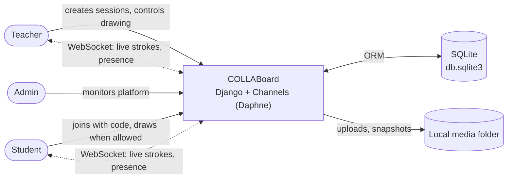

# COLLABoard Documentation

Project documentation for **COLLABoard**, the Collaborative Whiteboard built by CSIT327 Group 4.

| Document | What it answers | Main audience |
|---|---|---|
| [PRD.md](PRD.md): Product Requirements | *Why* we build it, for *whom*, which features, how we measure success | Whole team, instructor |
| [SRS.md](SRS.md): Software Requirements Specification | *What* the system must do: functional and non-functional requirements, use cases | Developers, testers |
| [SDD.md](SDD.md): Software Design Document | *How* it is built: architecture, modules, sequences, classes | Developers |
| [TRD.md](TRD.md): Technical Requirements | Stack, environments, configuration, security, performance, deployment | Developers, DevOps |
| [APP_FLOW.md](APP_FLOW.md): Application Flow | Every screen and how users move between them, per role | Designers, developers, testers |
| [UI_UX_DESIGN_BRIEF.md](UI_UX_DESIGN_BRIEF.md): UI/UX Design Brief | Visual identity, design tokens, components, accessibility | Designers, front-end |
| [BACKEND_SCHEMA.md](BACKEND_SCHEMA.md): Backend Schema | ER diagram, tables, HTTP API, realtime message protocol | Back-end, front-end |
| [IMPLEMENTATION_PLAN.md](IMPLEMENTATION_PLAN.md): Implementation Plan | What has been built, what was fixed, what comes next | Whole team |

## Conventions

* Diagrams are written in [Mermaid](https://mermaid.js.org/) and render directly on GitHub.
* Requirement IDs (`FR-xx`, `NFR-xx`) are defined in the SRS and referenced from the other documents.
* Paths such as `modules/session/views/` are relative to the repository root.
* All documents describe the code on branch `refine/fixes-and-docs` (October 2026).

## System at a glance

