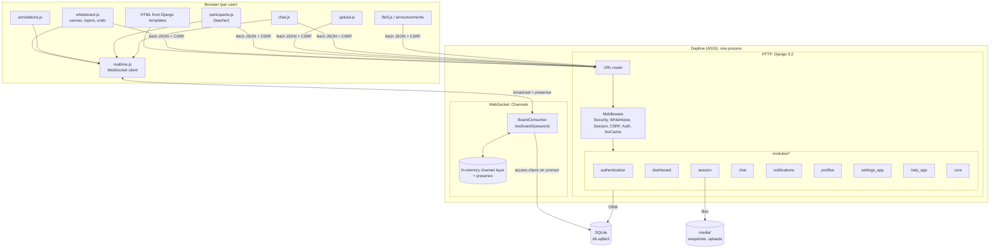
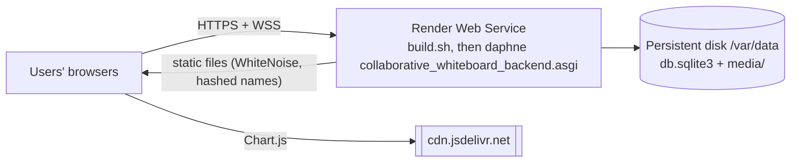
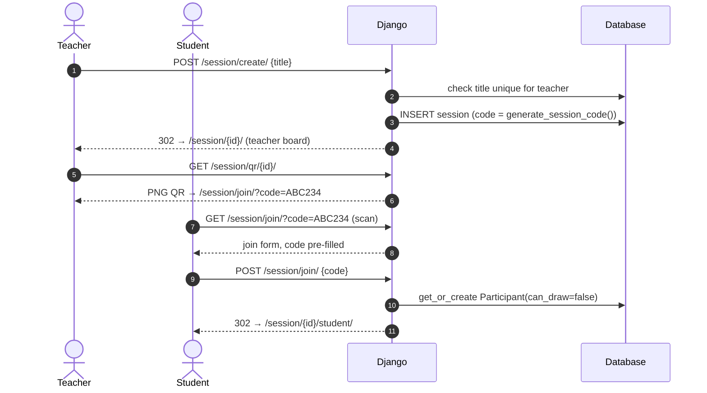
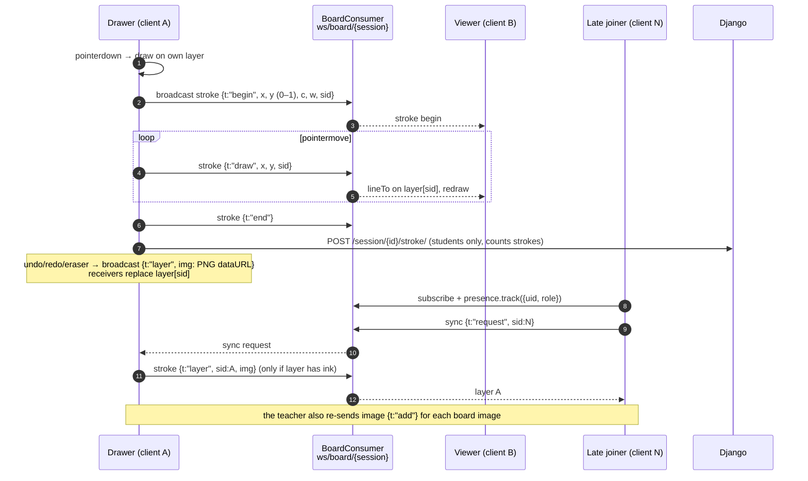
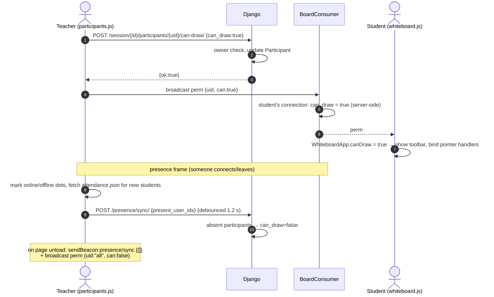
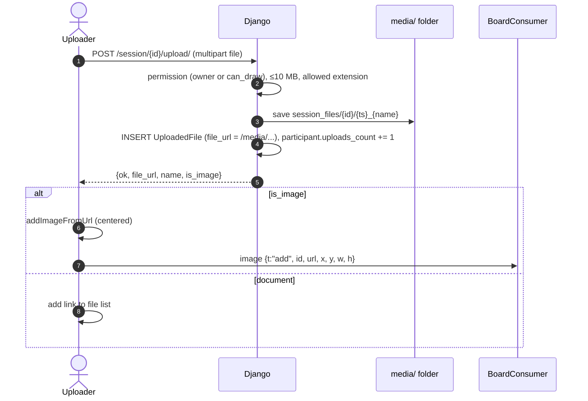
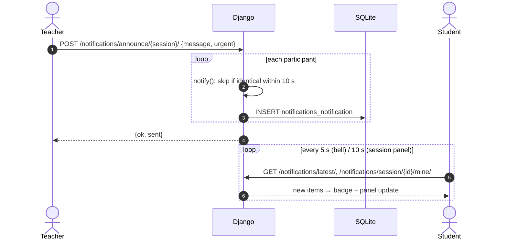
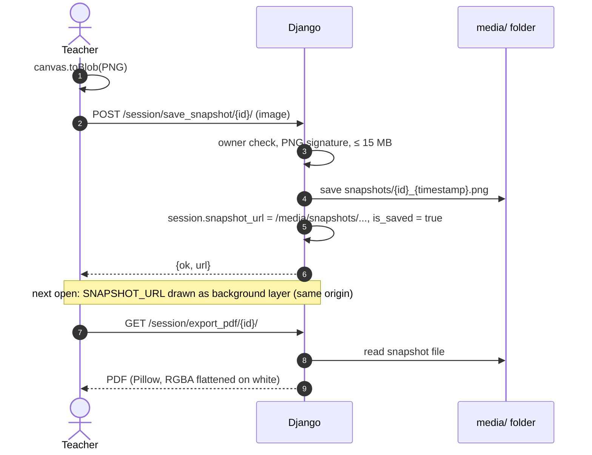
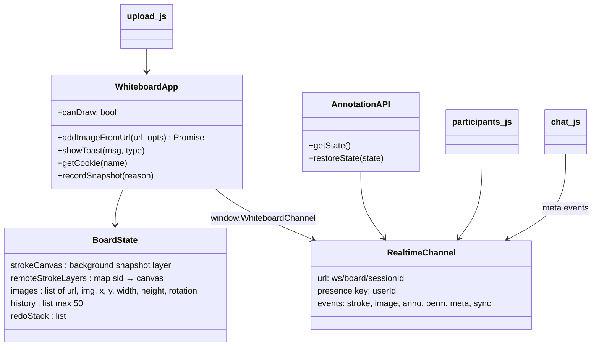
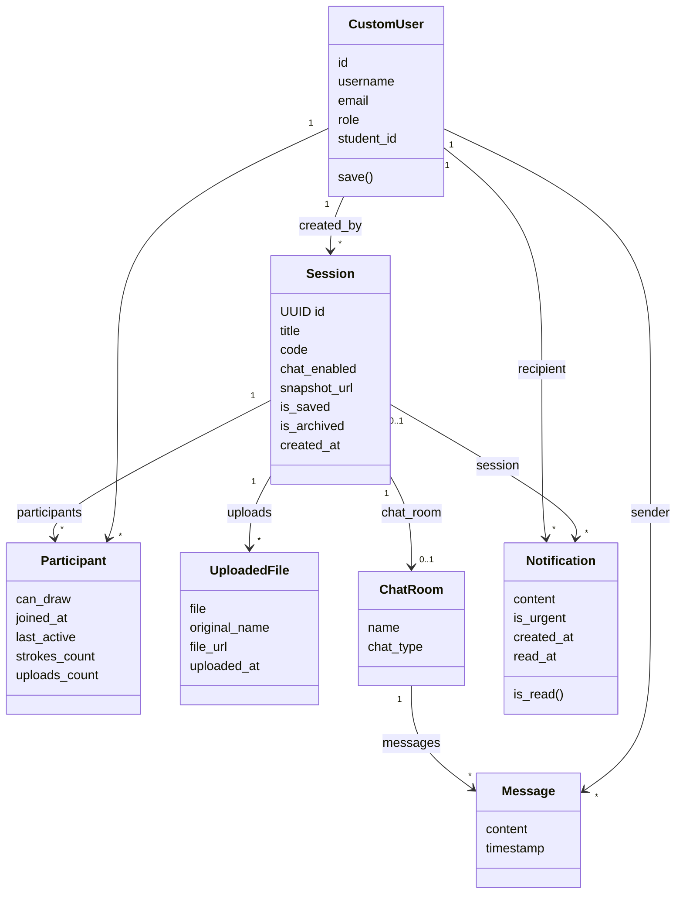

# Software Design Document (SDD)

**System:** COLLABoard: Collaborative Whiteboard
**Version:** 1.0 · **Date:** 2026-10-14
**Prepared by:** CSIT327 Group 4
**Format:** adapted from IEEE 1016

---

## 1. Introduction

This document describes *how* COLLABoard is built so a new developer can find, change and extend any part of it. Requirements are in the [SRS](SRS.md); tables and endpoints are in the [Backend Schema](BACKEND_SCHEMA.md).

## 2. Design goals and principles

1. **Server-rendered first.** Django templates render every page; JavaScript adds live behaviour on top. No SPA build step.
2. **One Django app per feature** under `modules/`, each with its own `models.py`, `views.py`, `urls.py`, `templates/<app>/`, `static/<app>/`.
3. **The server is the authority on permissions.** The browser hides buttons, but every action is re-checked in the view (owner / participant / `can_draw`).
4. **Self-contained.** One Daphne (ASGI) process serves pages, JSON APIs and WebSockets; data is one SQLite file plus a `media/` folder. No external backend service.
5. **Realtime is a thin relay.** The WebSocket consumer only checks rights and forwards events between clients of a session; it never stores or renders strokes, so it stays cheap.
6. **Graceful degradation.** If the socket drops, drawing continues locally; the client reconnects with backoff and re-syncs its layer.

## 3. Architecture

### 3.1 Logical architecture

### 3.2 Deployment view

Build (`build.sh`): `pip install -r requirements.txt` → `migrate` → `collectstatic`. Start: `daphne -b 0.0.0.0 -p $PORT collaborative_whiteboard_backend.asgi:application`. Exactly **one instance**: the channel layer and presence live in memory, and SQLite is a local file.

## 4. Module design

| Module | Responsibility | Key files |
|---|---|---|
| `core` | Landing redirect, media file serving, base layout (`core/base.html`), browser WebSocket client, shared decorators (`safe_view`), no-cache middleware, test helpers | `views.py`, `decorators.py`, `static/core/js/realtime.js`, `middleware/no_cache.py`, `testing.py` |
| `authentication` | `CustomUser` (role, student_id), signup form and validation, login (username **or** email), logout, `role_required` decorator, password complexity validator | `models.py`, `forms.py`, `backends.py`, `decorators.py`, `validators.py` |
| `dashboard` | Role redirect and the three dashboards with aggregated metrics | `views.py`, `static/dashboard/js/*_chart.js` |
| `session` | Sessions, participants, uploads; whiteboard pages; all board-related JSON APIs; realtime WebSocket consumer; attendance; QR; PDF export | `models.py`, `views/{base,whiteboard,manage,upload,api}_views.py`, `consumers.py`, `routing.py`, `static/session/js/*` |
| `chat` | One chat room per session, fetch/send messages, chat toggle respected | `models.py`, `views.py`, `static/chat/js/chat.js` |
| `notifications` | Notification model, `notify()` service, announcements, bell APIs, context processor for unread count | `models.py`, `notify.py`, `views.py`, `notifcounts.py` |
| `profiles` | Profile page, email edit | `views.py` |
| `settings_app` | Settings hub, password change (keeps session) | `views.py` |
| `help_app` | FAQ page | `templates/help_app/help.html` |

### 4.1 Authentication design
* `AUTH_USER_MODEL = authentication.CustomUser` extends `AbstractUser` with `role ∈ {student, teacher, admin}` and nullable unique `student_id`. `save()` forces `role='admin'` for superusers.
* `EmailOrUsernameModelBackend` authenticates by email (case-insensitive) when the identifier contains `@`, else by username, and hashes a dummy password on misses to limit timing leaks.
* `CustomSignupForm` normalizes email, requires `student_id` only for students (NULL for others, so the unique index never collides on `''`), and surfaces password-validator messages as form-level errors.
* `role_required([...])` redirects users without the role to `redirect_dashboard`.

### 4.2 Dashboard design
Teacher metrics are computed in two grouped queries (uploads per user, chat messages per user via `room__session__in`) plus one participants query, then folded into **one row per student** across all of the teacher's sessions. Strokes come from `Participant.strokes_count`, uploads from `UploadedFile`, and "last active" is the max of join, last activity, last upload and last message.

### 4.3 Session views split

| File | Views |
|---|---|
| `base_views.py` | `session_list`, `create_session`, `join_session`, `saved_sessions` |
| `whiteboard_views.py` | `whiteboard_view` (owner), `student_whiteboard_view` (participant); shared `_whiteboard_context` |
| `manage_views.py` | `delete_session`, `toggle_draw_permission`, `save_snapshot`, `export_session`, `toggle_chat`, `presence_sync`, `attendance_view`, `attendance_json` |
| `upload_views.py` | `upload_attachment`, `session_qr`, `export_session_pdf`, `duplicate_session` |
| `api_views.py` | `record_stroke` |

## 5. Dynamic behaviour (sequence diagrams)

### 5.1 Create and join a session

### 5.2 Live drawing and late-joiner sync

Every client keeps one offscreen canvas **layer per user id**. The visible canvas is redrawn as *white → background snapshot → images → every user layer*.

Design notes:
* Coordinates are normalized (0–1) so boards of different sizes stay aligned.
* Undo/redo are local to the user's layer and propagated as a full-layer sync. A previous design replayed "undo" on receivers, which undid *their own* strokes; that was removed.
* The consumer never echoes a message back to its sender, checks the sender's rights, and overwrites `sid` with the sender's real user id (see [Backend Schema §5.3](BACKEND_SCHEMA.md#53-server-side-rules)).
* `realtime.js` exposes the same small API the scripts used before (`on`, `send`, `subscribe`, `track`, `presenceState`), so board code is transport-agnostic.

### 5.3 Permission toggle and presence

### 5.4 Upload

### 5.5 Announcement and notification

### 5.6 Save snapshot and export

## 6. Client-side design (`whiteboard.js`)

* **Render loop:** `scheduleRedraw()` coalesces redraws with `requestAnimationFrame`.
* **History entries** store the user's layer pixels (`ImageData`), image placements and annotation state; a canvas resize invalidates history (pixel snapshots can't be rescaled safely).
* **Permission UI:** `WhiteboardApp.canDraw = v` binds or unbinds pointer handlers and shows the toolbar or the view-only banner.
* **Keyboard:** Ctrl/⌘+Z/Y and Delete/Backspace are ignored when the focus is in a text field.

## 7. Server-side domain model

`session.ChatMessage` still exists for backward compatibility but is **not used**; live chat uses `chat.Message`.

## 8. Security design

| Threat | Control |
|---|---|
| Unauthorized board access | `whiteboard_view` / `student_whiteboard_view` require owner/staff or Participant; outsiders → join page |
| Privilege escalation (students acting as teacher) | `role_required` on session management; owner checks on every teacher API; signup form only offers student/teacher |
| CSRF | Django middleware; JS sends `X-CSRFToken`. Only `presence_sync` is exempt (sendBeacon) and it is owner-only and can only *remove* permissions |
| XSS | Templates auto-escape; JS renders user text with `textContent`; participant names inserted via `textContent` |
| Malicious uploads | Extension allow-list (no HTML/SVG), 10 MB cap, sanitized file names, `X-Content-Type-Options: nosniff`; snapshots must be real PNGs |
| Board hijacking over WebSocket | Only owner/staff/participants can connect (session cookie); drawing events require `can_draw`; teacher-only events (`perm`, `meta`, `clear_all`) enforced server-side; `sid` overwritten with the real user id |
| Secret leakage | No third-party API keys exist; `SECRET_KEY` only in the environment; `.env` gitignored |
| Session hijack | Secure cookies when `DEBUG=False`, `SECURE_PROXY_SSL_HEADER` for Render, no-cache headers for authenticated pages |
| Brute force | Django password hashing (PBKDF2); recommend rate limiting at proxy (Implementation Plan) |

**Known limitations:** files under `/media/` are reachable by anyone who has the exact (unguessable) URL. A student whose drawing right was revoked can no longer send their layer to late joiners, so those joiners won't see that student's earlier strokes until the teacher saves a snapshot.

## 9. Error handling and logging
* `modules.core.decorators.safe_view` logs unhandled exceptions with the view name and swallows `BrokenPipeError` (client disconnected).
* JSON endpoints return `{"ok": false, "error": "<code>"}` with proper status codes (400/403/404/405/500).
* Front-end shows toasts (`WhiteboardApp.showToast`) and reverts optimistic UI on failure (draw toggle).
* `LOGGING` sends everything at `LOG_LEVEL` (default INFO) to stdout, which Render collects.

## 10. Design decisions log

| # | Decision | Alternatives | Reason |
|---|---|---|---|
| D1 | Django Channels with in-memory layer, Daphne | Supabase Realtime (used until Oct 2026); Channels + Redis | No external service to pay for or lose access to; server-side permission checks; single process is enough for class-sized sessions. Swap in `channels-redis` to scale out |
| D2 | Per-user canvas layers | Single shared bitmap | Lets erasers and undo affect only your own strokes |
| D3 | Raster snapshot as persistence | Store every stroke as vectors | Simple and good enough for v1; vector storage planned (v1.1) |
| D4 | Session title unique **per teacher** | Global unique | Two teachers must both be able to name a session "Algebra" |
| D5 | SQLite + local `media/` | Supabase Postgres + Storage; managed PostgreSQL | Zero setup, runs anywhere; needs a persistent disk in production. `DATABASE_URL` still switches to PostgreSQL |
| D7 | Client shim `realtime.js` mimicking the supabase-js channel API | Rewrite every board script | Kept the change to one line in `whiteboard.js`; other scripts untouched |
| D6 | Duplicate-suppression window for notifications | DB unique constraint | Constraint blocked legitimate repeated announcements |
