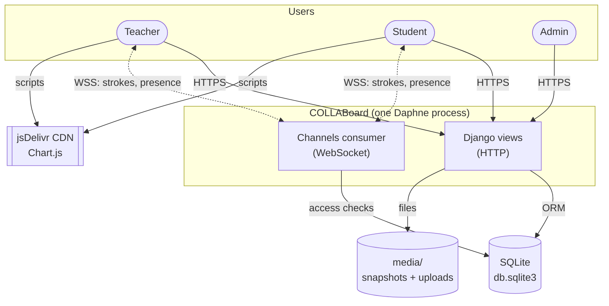
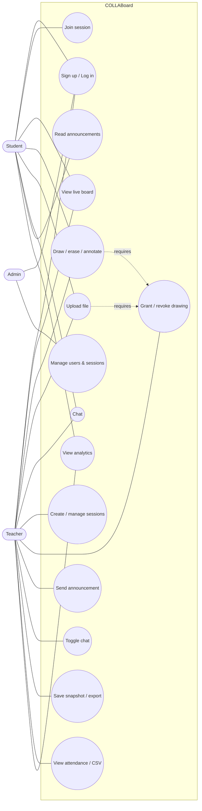
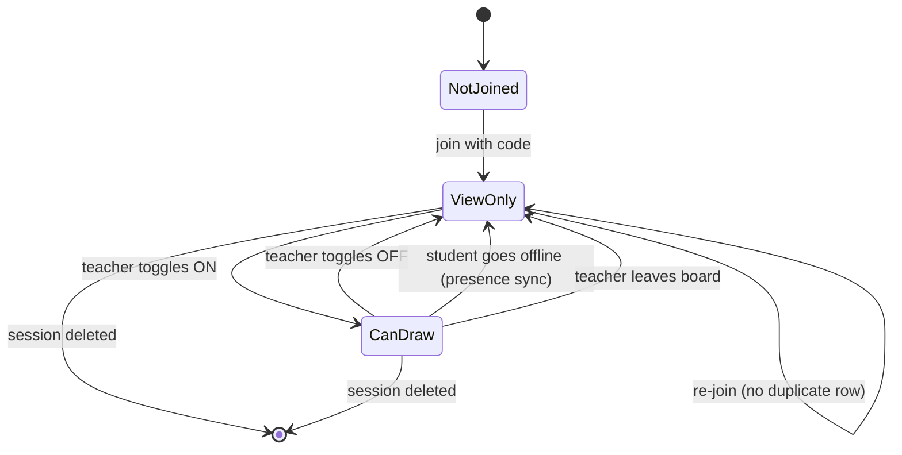

# Software Requirements Specification (SRS)

**System:** COLLABoard: Collaborative Whiteboard
**Version:** 1.0 · **Date:** 2026-10-14
**Prepared by:** CSIT327 Group 4
**Format:** adapted from IEEE 830 / ISO/IEC/IEEE 29148

---

## 1. Introduction

### 1.1 Purpose
This document specifies the functional and non-functional requirements of COLLABoard. It is the reference for design ([SDD](SDD.md)), implementation and testing.

### 1.2 Scope
COLLABoard is a Django web application that provides real-time shared whiteboards for classes. It covers account management, role-based dashboards, whiteboard sessions with live drawing, permission control, uploads, announcements, chat, notifications, snapshots, attendance and participation analytics.

### 1.3 Definitions

| Term | Meaning |
|---|---|
| **Session** | One whiteboard owned by a teacher, identified by a UUID and a 6-character join code |
| **Participant** | A student who joined a session (row in `session_participant`) |
| **Draw permission** (`can_draw`) | Whether a participant may draw, erase, annotate and upload |
| **Snapshot** | PNG image of the board saved on the server (`media/snapshots/`) |
| **Layer** | Per-user offscreen canvas that holds that user's strokes on every client |
| **Presence** | Live list, kept by the WebSocket server, of who currently has the board open |
| **Announcement** | Teacher message delivered as a notification to every participant |

### 1.4 References
[PRD](PRD.md), [SDD](SDD.md), [TRD](TRD.md), [Backend Schema](BACKEND_SCHEMA.md), Django 5.2 documentation, Django Channels 4 documentation.

---

## 2. Overall description

### 2.1 Product perspective (context diagram)

### 2.2 User classes

| Class | Created by | Capabilities |
|---|---|---|
| Student | Self-signup (Student ID required) | Join sessions, view board, draw/upload when permitted, chat, read announcements, own dashboard |
| Teacher | Self-signup | Everything a student can do, plus create/manage sessions, control permissions, announce, toggle chat, save/export, attendance, analytics |
| Admin | `createsuperuser` (role forced to `admin`) | Admin dashboard, Django Admin site (users, sessions, notifications, chat) |

### 2.3 Use case diagram

### 2.4 Operating environment
* Server: Python 3.11+ (tested on 3.13), Django 5.2 + Channels 4 on Daphne (ASGI), Render web service with a persistent disk.
* Database: SQLite (WAL mode). PostgreSQL remains possible via `DATABASE_URL`.
* Client: evergreen browsers with Canvas 2D, Pointer Events and WebSocket support.

### 2.5 Constraints
* Live sync uses the app's own WebSocket endpoint; if the socket is down the board must keep working locally and reconnect (NFR-08).
* The in-memory channel layer and SQLite require a **single server process**.
* Render's default filesystem is ephemeral, so the database and media must live on a persistent disk.
* Session codes must be easy to read aloud (no `0/O`, `1/I/L`).

### 2.6 Assumptions and dependencies
* Snapshot and upload files are served from the same origin (`/media/`), so the canvas can draw and export them without CORS issues.
* Notifications are delivered by polling (bell every 5 s, session announcements every 10 s).

---

## 3. Functional requirements

Priority: **M** = must, **S** = should, **C** = could.

### 3.1 Authentication and accounts (AUTH)

| ID | Requirement | Pri |
|---|---|---|
| FR-01 | The system shall let a visitor sign up with username, email, role (student/teacher), password and confirmation. | M |
| FR-02 | Students shall provide a unique Student ID; teachers shall not (stored as NULL). | M |
| FR-03 | Emails shall be stored lower-case and be unique (case-insensitive). | M |
| FR-04 | Passwords shall have ≥ 8 characters, one uppercase letter, one digit, one special character, and must not be common, numeric-only or similar to the username. Each rule's message is shown once. | M |
| FR-05 | Users shall log in with **username or email** plus password. | M |
| FR-06 | After login or signup the user shall be redirected to the dashboard for their role. | M |
| FR-07 | Logout shall require POST (CSRF-protected). | M |
| FR-08 | Users shall change their password in Settings and stay logged in on the current device. | S |
| FR-09 | Users shall be able to change their email (validated, unique); username and Student ID are read-only. | S |
| FR-10 | Superusers shall automatically get the `admin` role. Self-signup as admin is not possible. | M |

### 3.2 Dashboards (DASH)

| ID | Requirement | Pri |
|---|---|---|
| FR-11 | Student dashboard shall list joined sessions (newest first) with an Open link and a per-session strokes/uploads chart. | S |
| FR-12 | Teacher dashboard shall show session count, the 10 most recent sessions, and per-student totals (strokes, uploads, chat messages, last active) aggregated across the teacher's sessions, with a chart. | S |
| FR-13 | Admin dashboard shall show live counts of students, teachers, admins, sessions, joins, uploads, messages and the 10 latest sessions, with links to Django Admin. | C |

### 3.3 Session management (SESS)

| ID | Requirement | Pri |
|---|---|---|
| FR-14 | Teachers (and admins) shall create a session with a title of up to 100 characters; titles must be unique per teacher (case-insensitive). | M |
| FR-15 | Each session shall receive a unique 6-character code from `ABCDEFGHJKMNPQRSTUVWXYZ23456789`. | M |
| FR-16 | Teachers shall list and search their sessions by title or code. | S |
| FR-17 | Teachers shall show an invite QR code that opens the join page with the code pre-filled. | S |
| FR-18 | Teachers shall duplicate a session (new code, title "(copy)", "(copy 2)", …, same snapshot and chat setting). | C |
| FR-19 | Only the owner (or staff) shall delete a session; deletion requires POST and confirmation. | M |
| FR-20 | Students shall not access session-management pages. | M |

### 3.4 Joining and access control (JOIN)

| ID | Requirement | Pri |
|---|---|---|
| FR-21 | A logged-in user shall join with a code (case-insensitive). Joining creates one Participant (re-joining reuses it) with `can_draw = false`. | M |
| FR-22 | An invalid code shall show "Invalid session code". | M |
| FR-23 | Only the owner/staff may open the teacher board; participants are redirected to the student board; everyone else is sent to the join page. | M |
| FR-24 | The owner joining their own code shall be taken to the teacher board. | S |

### 3.5 Whiteboard (WB)

| ID | Requirement | Pri |
|---|---|---|
| FR-25 | Users with draw permission shall draw freehand with chosen color (picker) and size (1–20 px). | M |
| FR-26 | The eraser shall remove only the current user's own strokes. | M |
| FR-27 | Undo/redo (buttons, Ctrl/⌘+Z, Ctrl/⌘+Y, Ctrl/⌘+Shift+Z) shall affect only the current user's work, keep ≥ 50 steps, and sync the result to everyone. | M |
| FR-28 | Keyboard shortcuts shall be ignored while typing in an input/textarea (chat, announcements). | M |
| FR-29 | The teacher shall "Clear All" (with confirmation), clearing every client's strokes and images. | M |
| FR-30 | Users with permission shall add highlights and pins; "Clear Marks" removes all annotations. | S |
| FR-31 | Strokes, images, annotations and clears shall appear on all connected clients in real time. | M |
| FR-32 | A client that opens the board late shall receive existing strokes from connected users and the images from the teacher. | S |
| FR-33 | Everyone shall export the visible board as PNG. | S |
| FR-34 | View-only users shall see a "View-only mode" banner, no drawing tools, but keep Back and Export. | M |
| FR-35 | Each finished stroke by a student shall increment that student's stroke count. | S |

### 3.6 Permissions and presence (PERM)

| ID | Requirement | Pri |
|---|---|---|
| FR-36 | The teacher panel shall list participants with an online/offline dot from WebSocket presence and add newly joined students automatically. | M |
| FR-37 | The teacher shall toggle `can_draw` per participant; the change applies on the student's screen immediately. If saving fails, the toggle reverts. | M |
| FR-38 | When a participant goes offline, the server shall revoke their draw permission. When the teacher leaves, all draw permissions are revoked. | S |

### 3.7 Uploads (UPL)

| ID | Requirement | Pri |
|---|---|---|
| FR-39 | Teachers, and students with draw permission, shall upload PNG, JPG, GIF, WEBP, PDF, DOCX or PPTX files up to 10 MB. | S |
| FR-40 | Images shall be placed on the board (move, resize, rotate with Shift+wheel, delete) and synced; other files are listed as links. | S |
| FR-41 | Each upload shall be recorded (session, uploader, original name, URL) and counted for analytics. | S |

### 3.8 Communication (COMM)

| ID | Requirement | Pri |
|---|---|---|
| FR-42 | The teacher shall send an announcement (≤ 1000 chars, optional urgent flag) to all participants of the session. | S |
| FR-43 | Identical announcements within 10 s shall be treated as a double-click and sent once; later repeats shall be sent. | S |
| FR-44 | Students shall see the session's announcements in a side panel (refreshed every 10 s). | S |
| FR-45 | All users shall have a notification bell with unread count, latest 20 items, mark-all-read on open (POST), and a full notifications page. | S |
| FR-46 | Session members shall chat (≤ 1000 chars per message); messages poll every 5 s. | S |
| FR-47 | The teacher shall enable/disable chat; the change applies to all clients immediately and the server rejects messages while disabled. | S |

### 3.9 Persistence, export and records (REC)

| ID | Requirement | Pri |
|---|---|---|
| FR-48 | The teacher shall save a snapshot (PNG, validated, ≤ 15 MB) on the server. The latest snapshot becomes the board background on next open. | S |
| FR-49 | Saved Sessions shall list sessions with snapshots, with PNG and PDF download and an Open Board link. | S |
| FR-50 | The attendance page shall list participants (username, email, joined, last active), refresh live, and export CSV (including strokes and uploads). | M |

### 3.10 Participant permission state machine

---

## 4. External interface requirements

### 4.1 User interfaces
Server-rendered HTML pages with a collapsible sidebar (see [UI/UX Brief](UI_UX_DESIGN_BRIEF.md) and [App Flow](APP_FLOW.md)). Pages must be usable from 360 px width up.

### 4.2 Software interfaces
| Interface | Use |
|---|---|
| SQLite | Primary database (`SQLITE_PATH`); PostgreSQL optional via `DATABASE_URL` |
| Local file system | Snapshot and upload files (`MEDIA_ROOT`, served at `/media/`) |
| WebSocket | `/ws/board/<session_id>/`: broadcast + presence, see [Backend Schema §5](BACKEND_SCHEMA.md#5-realtime-protocol-websocket) |
| JSON HTTP endpoints | See [Backend Schema §4](BACKEND_SCHEMA.md#4-http-api) |

### 4.3 Communication interfaces
HTTPS for pages and JSON APIs; WSS for the whiteboard socket (authenticated by the Django session cookie). All state-changing requests carry the Django CSRF token, except `presence/sync/` (sent with `navigator.sendBeacon` on page unload; owner-only).

---

## 5. Non-functional requirements

| ID | Category | Requirement |
|---|---|---|
| NFR-01 | Performance | Stroke broadcast latency p50 ≤ 300 ms, p95 ≤ 800 ms on a typical school connection. |
| NFR-02 | Performance | Server-rendered pages respond in ≤ 1 s (p95) excluding cold starts. |
| NFR-03 | Capacity | A session supports at least 50 simultaneous viewers and 10 simultaneous drawers. |
| NFR-04 | Security | All views except login/signup/landing require authentication; ownership is checked server-side for every teacher action. |
| NFR-05 | Security | CSRF protection on all POSTs (one documented exemption); secure cookies and HTTPS in production; WebSocket access limited to the session's owner and participants, with drawing rights enforced on the server. |
| NFR-06 | Security | User-generated text is rendered with auto-escaping (templates) or `textContent` (JS), never raw HTML. |
| NFR-07 | Reliability | Unhandled exceptions are logged with the view name; client disconnects do not produce error noise. |
| NFR-08 | Availability | The app needs no external services. If the WebSocket drops, drawing continues locally and the client reconnects and re-syncs automatically. |
| NFR-09 | Usability | A first-time student can join a session without help; all primary actions are reachable in ≤ 2 clicks from the dashboard. |
| NFR-10 | Accessibility | Toolbar controls have ARIA labels and keyboard activation; status messages use `aria-live`; color is not the only signal (banner text for view-only). |
| NFR-11 | Compatibility | Latest two versions of Chrome, Edge, Firefox, Safari; touch input via Pointer Events. |
| NFR-12 | Maintainability | Modular Django apps per feature; automated test suite (`python manage.py test modules`) passes before merge. |
| NFR-13 | Portability | Configuration only through environment variables (`.env.example`). |
| NFR-14 | Data retention | Sessions, participants, messages and notifications persist until the session or user is deleted (cascade). |

---

## 6. Traceability (requirement → design → test)

| Requirement(s) | Design reference | Test (module) |
|---|---|---|
| FR-01–FR-07, FR-10 | SDD §4.1 | `modules/authentication/tests.py` |
| FR-09 | SDD §4.1 | `modules/dashboard/tests.py::PageSmokeTests` |
| FR-11–FR-13 | SDD §4.2 | `modules/dashboard/tests.py` |
| FR-14–FR-24 | SDD §4.3, §5.1 | `modules/session/tests.py::SessionManagementTests`, `JoinAndAccessTests` |
| FR-25–FR-35 | SDD §5.2, §6 | `modules/session/test_realtime.py`, manual test plan (Implementation Plan §6), `record_stroke` tests |
| FR-36–FR-38 | SDD §5.3 | `WhiteboardApiTests` (presence sync), `test_realtime.py` (presence, perm) |
| FR-39–FR-41 | SDD §5.4 | `UploadTests` |
| FR-42–FR-47 | SDD §5.5 | `modules/notifications/tests.py`, `modules/chat/tests.py` |
| FR-48–FR-50 | SDD §5.6 | `WhiteboardApiTests` (snapshot → media → PDF, attendance CSV) |
