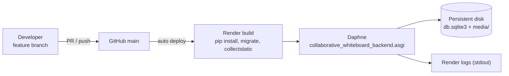

# Technical Requirements Document (TRD)

**System:** COLLABoard: Collaborative Whiteboard
**Version:** 1.1 · **Date:** 2026-10-14 · **Change:** Supabase removed; SQLite + local media + Django Channels WebSockets

This document fixes the technical choices, environments, configuration and quality bars that the implementation must meet. Functional behaviour is in the [SRS](SRS.md); design is in the [SDD](SDD.md).

---

## 1. Technology stack

| Layer | Technology | Version (pinned in `requirements.txt`) | Notes |
|---|---|---|---|
| Language | Python | 3.11 – 3.13 (tested on 3.13.7) | |
| Web framework | Django | 5.2.6 | Server-rendered templates, ORM, auth, admin |
| Realtime | Django Channels | 4.3.2 | WebSocket consumer, in-memory channel layer |
| ASGI server | Daphne | 4.2.3 | Serves HTTP **and** WebSockets; also powers `runserver` |
| API helpers | Django REST Framework | 3.16.1 | Installed; current JSON endpoints are plain Django views |
| Database | SQLite (stdlib `sqlite3`) | | WAL mode, `IMMEDIATE` transactions, 20 s busy timeout |
| Optional DB | PostgreSQL via `psycopg2` + `dj-database-url` | 2.9.10 / 3.0.1 | Only when `DATABASE_URL` is set |
| Static files | WhiteNoise | 6.11.0 | `CompressedManifestStaticFilesStorage` (hashed, compressed) |
| Config | python-dotenv | 1.1.1 | Loads `.env` |
| Images / PDF | Pillow | 11.3.0 | Snapshot → PDF |
| QR codes | qrcode | 8.2 | Invite QR |
| WSGI server (fallback) | Gunicorn | 23.0.0 | Serves pages only (no WebSockets); kept so an old start command still boots |
| Front-end | HTML5, CSS3, vanilla JavaScript (ES2020) | | No build step; `core/js/realtime.js` WebSocket client |
| Charts | Chart.js (CDN) | 4.4.1 | Dashboards |
| Hosting | Render Web Service + persistent disk | | `build.sh` |

No third-party backend service is required.

## 2. Environments

| Environment | Database | Files | DEBUG | URL |
|---|---|---|---|---|
| Local dev | `./db.sqlite3` | `./media/` | `True` (default when `RENDER` unset) | http://127.0.0.1:8000 (`manage.py runserver`, Daphne) |
| Test (`manage.py test`) | SQLite in memory | temp folder (`CollaboardTestCase`) | False | n/a |
| Production | `SQLITE_PATH` on a persistent disk | `MEDIA_ROOT` on the same disk | `False` (default when `RENDER=true`) | https://collaboard-z4sx.onrender.com |

## 3. Configuration (environment variables)

All configuration is read in `collaborative_whiteboard_backend/settings.py`. Template: [`.env.example`](../.env.example).

| Variable | Required in prod | Default | Purpose |
|---|---|---|---|
| `SECRET_KEY` | **Yes** | insecure dev key | Django signing key. Must be a long random value in production |
| `DEBUG` | No | `False` on Render, else `True` | Never `True` in production |
| `ALLOWED_HOSTS` | No | `collaboard-z4sx.onrender.com, localhost, 127.0.0.1` + `RENDER_EXTERNAL_HOSTNAME` | Extra comma-separated hosts (also used by the WebSocket origin check) |
| `SQLITE_PATH` | **Yes on Render** | `./db.sqlite3` | Database file; put it on the persistent disk (e.g. `/var/data/db.sqlite3`) |
| `MEDIA_ROOT` | **Yes on Render** | `./media` | Snapshots and uploads (e.g. `/var/data/media`) |
| `DATABASE_URL` | No | unset | If set, PostgreSQL is used instead of SQLite |
| `LOG_LEVEL` | No | `INFO` | Root log level |

Derived settings: `ASGI_APPLICATION`, `CHANNEL_LAYERS` (in-memory), `CSRF_TRUSTED_ORIGINS` (https:// + every non-local host), `SECURE_PROXY_SSL_HEADER` (Render TLS), `SESSION_COOKIE_SECURE`/`CSRF_COOKIE_SECURE` when not DEBUG, `DATA_UPLOAD_MAX_MEMORY_SIZE = 15 MB`, `TIME_ZONE = Asia/Manila`.

> **Render migration note:** if the Render service still has `DATABASE_URL` pointing at the old Supabase database, **delete that variable**. Otherwise the app keeps trying to use it. Also delete the old `SUPABASE_*` variables (they are ignored now).

## 4. Data and file storage requirements

1. **Database:** a single SQLite file. On startup each connection enables WAL journaling (`PRAGMA journal_mode=WAL`), so readers never block the writer; writes use `BEGIN IMMEDIATE` with a 20 s busy timeout to avoid "database is locked" under concurrent HTTP and WebSocket access.
2. **Files** (`MEDIA_ROOT`):
   * `snapshots/<session_uuid>_<unix_ts>.png`: saved boards
   * `session_files/<session_uuid>/<unix_ts>_<filename>`: uploads
3. Files are served by the app at `/media/…` in every environment (`modules.core.views.media`) and are same-origin, so the canvas can draw and export them.
4. **Persistence:** on Render the default filesystem is wiped on every deploy and restart. A **persistent disk** must be mounted (e.g. `/var/data`) and `SQLITE_PATH`/`MEDIA_ROOT` pointed at it. Without it, accounts, sessions and uploads disappear.
5. **Backups:** copy `db.sqlite3` with `sqlite3 db.sqlite3 ".backup backup.sqlite3"` (safe while running) and archive `media/`.

## 5. Realtime requirements

| ID | Requirement | Implementation |
|---|---|---|
| TR-R1 | WebSocket endpoint per session | `ws(s)://<host>/ws/board/<session_uuid>/` → `BoardConsumer` |
| TR-R2 | Only session members connect | Session-cookie auth (`AuthMiddlewareStack`) + owner/staff/participant check; others closed with code 4403 |
| TR-R3 | Origin check | `AllowedHostsOriginValidator` (origin host must be in `ALLOWED_HOSTS`) |
| TR-R4 | Server-side rights | Draw events need `can_draw`; `perm`, `meta`, `clear_all` teacher-only; `sid` forced to the sender |
| TR-R5 | Presence | Maintained by the server per session; full state pushed on every change |
| TR-R6 | Resilience | Client reconnects with exponential backoff (≤ 10 s), re-tracks presence and re-syncs layers |
| TR-R7 | Message size | ≤ 2 MB per frame (layer images) |
| TR-R8 | Single process | In-memory channel layer: run **one** Daphne process/instance. To scale out, switch `CHANNEL_LAYERS` to `channels_redis` and the DB to PostgreSQL |

## 6. Performance requirements

| ID | Metric | Target | How it is achieved |
|---|---|---|---|
| TR-P1 | Stroke propagation | p50 ≤ 300 ms | One hop through the consumer; normalized points; no DB access per stroke |
| TR-P2 | Image move/resize broadcast rate | ≤ 12.5 msg/s per user | 80 ms throttle in `whiteboard.js` |
| TR-P3 | Redraw cost | ≤ 1 redraw per animation frame | `requestAnimationFrame` coalescing |
| TR-P4 | Dashboard queries | O(1) queries regardless of student count | Grouped aggregates (`values().annotate()`) |
| TR-P5 | Static assets | Long-term cache with hashed names, compressed | WhiteNoise manifest storage |
| TR-P6 | Upload size | ≤ 10 MB files, ≤ 15 MB request body / snapshot | Validation in views, `DATA_UPLOAD_MAX_MEMORY_SIZE` |
| TR-P7 | DB concurrency | No "database is locked" errors at class scale (~50 users) | WAL + immediate transactions + busy timeout |

## 7. Security requirements

| ID | Requirement | Implementation |
|---|---|---|
| TR-S1 | Passwords hashed with a slow KDF | Django PBKDF2 (default hasher) |
| TR-S2 | Password policy | Min length 8, similarity, common, numeric, plus `ComplexPasswordValidator` (upper, digit, special) |
| TR-S3 | HTTPS/WSS only in production | Render TLS + `SECURE_PROXY_SSL_HEADER`, secure cookies; `realtime.js` uses `wss://` on https pages |
| TR-S4 | CSRF on all state changes | Django middleware; `X-CSRFToken` from JS; single documented exemption (`presence_sync`) |
| TR-S5 | Authorization checked server-side | Owner/participant/`can_draw` checks in each view and in the WebSocket consumer; `role_required` |
| TR-S6 | No secrets in the repo or the browser | `.env` gitignored; no API keys exist any more |
| TR-S7 | Upload restrictions | Extension allow-list (no HTML/SVG), size cap, `get_valid_filename`, nosniff; snapshots must have a PNG signature |
| TR-S8 | Clickjacking protection | `XFrameOptionsMiddleware` (DENY) |
| TR-S9 | Authenticated pages not cached | `NoCacheForAuthMiddleware` |
| TR-S10 | Deploy check | `python manage.py check --deploy` reviewed before release (HSTS optional) |

## 8. Build, deploy and operations

* **Build command:** `./build.sh`
* **Start command (set in the Render dashboard):** `daphne -b 0.0.0.0 -p $PORT collaborative_whiteboard_backend.asgi:application`
  The old `gunicorn collaborative_whiteboard_backend.wsgi:application` still boots, but without WebSockets the board would not sync.
* **Disk:** Render → service → *Disks* → mount path `/var/data`; env `SQLITE_PATH=/var/data/db.sqlite3`, `MEDIA_ROOT=/var/data/media`. (Render disks require a paid instance; the free tier has no persistent storage.)
* **Instances:** exactly 1.
* **Migrations** run on each deploy (`migrate --noinput`).
* **Admin:** `python manage.py createsuperuser` in the Render shell (gets `role=admin`); Django Admin at `/admin/`.

## 9. Testing requirements

| Level | Tooling | Scope / command |
|---|---|---|
| Unit + integration | Django `TestCase` / `TransactionTestCase`, Channels `WebsocketCommunicator` | `python manage.py test modules`: 67 tests covering auth, sessions, access control, HTTP APIs, the WebSocket consumer (auth, relay, rights, presence), uploads, snapshot → media → PDF, chat, notifications, dashboards, page rendering |
| Static checks | `manage.py check`, `makemigrations --check`, `node --check` on edited JS | Before each PR |
| Live realtime E2E | Daphne + two logged-in clients running the real `realtime.js` | Verified for this release: connect, presence, relay, view-only block, permission grant, `sid` enforcement, teacher-only clear, disconnect |
| Manual E2E | Two browsers (teacher + student) | Checklist in [Implementation Plan §6](IMPLEMENTATION_PLAN.md#6-test-plan) |
| Deploy | `collectstatic` with `DEBUG=False`, `check --deploy`, production-mode smoke (Daphne, static, media, PDF) | Before release |

## 10. Logging and monitoring
* Python `logging` to stdout at `LOG_LEVEL`; `safe_view` logs stack traces with the view name; Daphne logs every HTTP request and WebSocket connect/disconnect.
* Browser: `window.DEBUG = true` in the console enables verbose realtime/chat logs.
* Recommended: Render health check on `/auth/login/`, uptime monitor, disk usage alert.

## 11. Technical constraints and known limitations

| Limitation | Effect | Plan |
|---|---|---|
| Single process (in-memory channel layer, SQLite) | Cannot run several instances | Redis channel layer + PostgreSQL when needed |
| Needs a persistent disk in production | Without one, all data is lost on deploy/restart | Render disk (paid) or move to PostgreSQL via `DATABASE_URL` |
| Board state lives only in connected clients + latest snapshot | If everyone leaves without saving, strokes since the last save are lost | Persist strokes server-side (R-01) |
| `/media/` files not access-controlled | Anyone with the exact URL can download a file | Serve through a permission-checked view (R-11) |
| Participant has no DB unique constraint on (user, session) | A rare double-submit race could create duplicates | Add constraint (R-05) |
| No password reset by email | Users who forget passwords need an admin | Configure email backend + reset views (R-02) |
