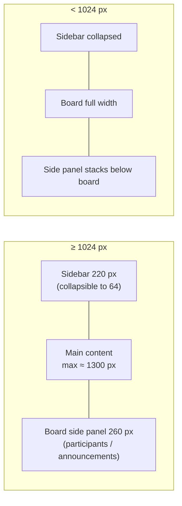

# UI/UX Design Brief

**Product:** COLLABoard: Collaborative Whiteboard
**Version:** 1.0 · **Date:** 2026-10-14

This brief describes the visual language that already exists in the code (so new screens match it) and the UX rules every screen must follow.

---

## 1. Design intent

> **"A teacher's notebook that comes alive."**

COLLABoard should feel like graph paper, sticky notes and marker pens, not a corporate dashboard. It must stay friendly for students (playful, informal) while the teacher can run a class from it without hunting for controls.

**Tone keywords:** playful · hand-made · clear · calm · classroom-safe

## 2. Audience and context

| User | Device | Context | Design consequence |
|---|---|---|---|
| Teacher | Laptop, often projected | Talking while operating the board | Large, labeled buttons; important controls always visible; no hover-only actions |
| Student | Phone, tablet, school PC | Joins mid-class, mostly watching | Join in one field; clear "view-only" state; board fills the screen |
| Admin | Desktop | Occasional | Simple cards linking to Django Admin |

## 3. Visual identity

### 3.1 Style: "sketchbook neo-brutalism"
* Paper backgrounds (graph texture on app pages, animated drawn lines and paper noise on auth pages).
* Dark ink outlines: `2px solid #333` with hard, unblurred offset shadows (`4px 4px 0 #333`, `8px 8px 0 #333` for hero cards).
* Rounded but not pill-shaped corners: 6–14 px.
* Yellow highlighter accent behind headings (`text-shadow: 2px 2px 0 #f9d342`).

### 3.2 Color tokens

Defined in `modules/core/static/core/css/base.css` (`:root`). Reuse these instead of new hex values.

| Token | Value | Use |
|---|---|---|
| `--accent` | `#2ca866` | Primary actions, active states, chart "strokes" |
| `--accent-dark` | `#24926d` | Hover/pressed primary |
| `--surface` | `#FFFAE7` | Page/paper background |
| `--card-bg` | `#ffffff` | Cards, canvas |
| `--sidebar-bg` | `#253444` | Sidebar |
| `--text-dark` | `#2c3e50` | Headings, body text |
| `--muted` | `#666666` | Secondary text |
| `--border` | `#e8e8e8` | Light dividers |
| Ink | `#333333` | Outlines, hard shadows |
| Highlighter | `#f9d342` | Heading shadow, emphasis |
| Note yellow | `#fffbe6` / `#fffdf4` | Upload area, side panels |
| Info blue | `#3498db` | Active tool, image selection |
| Success | `#2ecc71` / `#27ae60` | Save, success toasts |
| Danger | `#e74c3c` / `#c0392b` | Clear All, Delete, error toasts |
| Warning | `#ff9f1c` | Chart "uploads" series |

**Contrast rule:** body text on `--surface` and white must stay ≥ 4.5:1 (`#2c3e50` on `#FFFAE7` ≈ 10:1 ✔). White text is allowed only on `--accent-dark`, `--sidebar-bg`, danger or info colors.

### 3.3 Typography

| Role | Font stack | Size |
|---|---|---|
| App UI | `"Comic Sans MS", "Segoe UI", Roboto, sans-serif` | 15–16 px base |
| Auth brand title | `"Pacifico", "Comic Sans MS", cursive` | 28–36 px |
| Dense data (tables, toasts) | `system-ui, "Segoe UI", Roboto, Arial` | 12–14 px |
| Page title (h1) | App UI stack, bold | 1.6–2 rem |

Keep at most two families per screen. Never set body text below 12 px.

### 3.4 Spacing, radius and elevation

| Token (proposed name) | Value |
|---|---|
| `--space-1 … --space-5` | 4, 8, 12, 16, 24 px |
| `--radius-s / m / l` | 6 / 10 / 14 px |
| `--shadow-card` | `4px 4px 0 #333` |
| `--shadow-hero` | `8px 8px 0 #333` |
| Sidebar width | 220 px expanded / 64 px collapsed |
| Top bar height | 72 px |

### 3.5 Iconography
PNG icons in `modules/core/static/core/icons/` (bell, dashboard, profile, chat, settings, help, logout, plus). Emoji are used as lightweight icons in content (📢 announcements, 👥 participants, 📁 upload, ⚠️ urgent). Every icon-only control needs an `aria-label` or visible text.

## 4. Layout



### 4.1 Whiteboard screen anatomy

```
┌──────────────────────────────────────────────────────────────────────┐
│ [← Back]   Algebra   Code: ABC234   (Student view)     [Export PNG]  │  title row: always visible
├──────────────────────────────────────────────────┬───────────────────┤
│ Color ▣  Size ━━●━  [Pen][Eraser][Undo][Redo]    │ 👥 Participants    │
│ [Clear Marks][Highlight][Pin] [Clear All][Save]  │ ● paolo     [on ]  │
│ [Disable Chat]  ┊📁 Upload┊                      │ ○ maria     [off]  │  teacher only
├──────────────────────────────────────────────────┤                   │
│                                                  │ 📢 Send            │
│                  CANVAS (white)                  │ [............]     │
│                                                  │ ☐ Urgent  [Send]   │
│                                                  │                   │
├──────────────────────────────────────────────────┤ sent list…        │
│ worksheet.pdf · diagram.png  (uploaded files)    │                   │
└──────────────────────────────────────────────────┴───────────────────┘
 View-only students: toolbar replaced by "👀 View-only mode — waiting for teacher permission"
```

## 5. Components

| Component | Spec | Where |
|---|---|---|
| **Button** | 8–12 px padding, radius 6–10 px, ink outline on primary cards. Variants: `.btn` (accent), `.btn-primary` (green), `.btn-secondary` (gray `#bdc3c7`), `.btn-success`, `.btn-danger`. `.active` = blue fill | Everywhere |
| **Card** | White, `2px solid #333`, radius 10–14 px, `4px 4px 0 #333` | Dashboards, auth, profile |
| **Toolbar** | Flex-wrap row, 6–8 px gaps; tool toggles use `aria-pressed` | Whiteboard |
| **Switch** | 36×18 px slider; green when on; label "Allow {name} to draw" | Participants panel |
| **Presence dot** | Green online / gray offline + list order | Participants panel |
| **Toast** | Bottom center, 2.5 s, `role="status"`, `aria-live="polite"`; info gray, success green, error red | Whiteboard |
| **Banner** | Full-width gray bar with text, never color alone | View-only mode |
| **Modal** | Centered card on dimmed backdrop; close button + click-outside | Invite QR |
| **Badge** | Red pill with count; hidden at 0 | Notification bell, chat |
| **Chat window** | Floating bottom-right, header with minimize/close, log region `aria-live` | Board pages |
| **Charts** | Chart.js bars; strokes `#2ca866`, uploads `#ff9f1c`; begin at zero; responsive | Dashboards |

## 6. UX principles and rules

1. **Show state, don't hide it.** View-only, chat disabled, saving and uploading always have visible text, not just a disabled control.
2. **Teacher controls are one click away** on the board: permission switches, Clear All, Save, chat toggle.
3. **Destructive actions confirm.** Delete session and Clear All use `confirm()`; delete buttons are red and placed last.
4. **Never trap the user.** Back and Export stay visible even in view-only mode.
5. **Forgiving input.** Session codes are case-insensitive and avoid look-alike characters; login accepts username or email; QR pre-fills the code.
6. **Optimistic but honest.** UI updates immediately (strokes, toggles), but reverts and explains on failure.
7. **Typing is sacred.** Keyboard shortcuts (undo, delete image) never fire while the focus is in a text field.
8. **Consistent language.** "Session" (not class/room), "Join code", "Allow drawing", "Announcement", "Snapshot".

## 7. Accessibility checklist (WCAG 2.1 AA target)

- [x] Toolbar buttons have `aria-label`, keyboard Enter/Space activation, `aria-pressed` for tool toggles
- [x] Status regions (`uploadStatus`, toasts, chat log) use `aria-live`
- [x] Canvas has `aria-label`; all canvas actions also have a button equivalent (Export, Clear)
- [x] Color is never the only cue (view-only banner text, "Urgent" ⚠️ icon + text)
- [ ] Visible focus ring on all custom buttons (audit `outline: none` rules)
- [ ] Respect `prefers-reduced-motion` for the animated auth background and title fade-in
- [ ] Provide a dark-mode-friendly high-contrast option for projected classrooms
- [ ] Minimum 44×44 px touch targets for toolbar on phones

## 8. Responsive behaviour

| Breakpoint | Behaviour |
|---|---|
| ≥ 1024 px | Sidebar expanded; board + 260 px side panel side by side |
| < 1024 px | Side panel moves below the board at full width (max 600 px); toolbar centers and wraps |
| ≤ 768 px | Dashboard grids collapse to one column; tables scroll horizontally |
| ≤ 480 px | Auth card full width; chat window full width |

The canvas height is `max(500 px, viewport − 220 px)` with 1:1 pixel mapping for accurate pointer alignment.

## 9. Content and microcopy

| Situation | Copy |
|---|---|
| View-only | "👀 View-only mode — waiting for teacher permission" |
| Permission granted / revoked | "You can now draw." / "You are in view-only mode." |
| Join error | "Invalid session code" |
| Chat off | "Chat Disabled: The teacher has disabled chat for now." |
| Empty sessions (teacher) | "No sessions yet." / "No sessions match "{query}"." |
| Empty sessions (student) | "No sessions yet. Join one with the code your teacher gives you." |

Use sentence case, short verbs on buttons ("Save", "Send", "Join"), and emoji only as decoration next to text.

## 10. Design backlog

| # | Item | Why |
|---|---|---|
| UX-1 | Move hard-coded colors in session/dashboard CSS to the `:root` tokens | Consistency and future dark mode |
| UX-2 | Tool icons (pen, eraser, undo…) with text labels on wide screens | Faster recognition on projected screens |
| UX-3 | "Raise hand" button for students | Students can ask for the pen without chat |
| UX-4 | Unsaved-changes indicator next to Save | Prevent lost work |
| UX-5 | Onboarding tooltip on first board visit | Explain view-only and drawing permission |
| UX-6 | Replace browser `confirm()` with a styled dialog | Matches visual identity, better on mobile |
